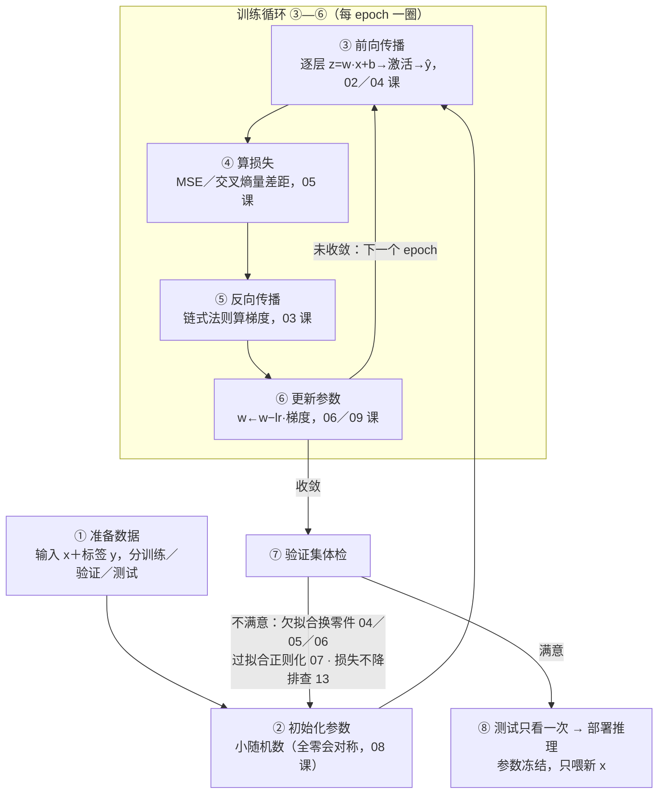

# 第三阶段 · 深度学习核心：中文学习导航

> 整理日期：2026-11-06。按原项目第三阶段全部 13 课整理，不删课。每课均按「零、初学者先读 + 十一节」模板撰写。必要代码在对应 Markdown 正文内，不创建代码附件、独立脚本或独立 Ship It 文件。
>
> 原文抓取说明：13 课全部用课程页 URL（`aiengineeringfromscratch.com/lesson?path=...`）抓取成功，内容以课程页为准，无凭记忆编写的内容。
>
> 2026-11-10 更新：01 课问答式精学增补六处——0.3 开头加与逻辑回归的对照表（感知机＝换了开关与学法的逻辑回归，地基只有 z=w·x+b 与决策线两条）；0.3 第一段后增两个“为什么”（x=0 推不动权重因乘积恒 0、b 无输入陪着被两类错误来回拉锯）；“三个规律”段后增多轮收敛表（4 轮收敛 w=[0.2,0.1]、b=−0.2，错误数 2→3→3→0 非单调）与 (1,0) 处 z 恰为 0 的浮点刀刃边界；2.3 增 error×x“自动方向选择器”三情况表，并核对修正早先“x_i<0 时压低 z”的表述（被压低的是 w_i，乘积负负得正、z 照样被推高）；0.3 第二段末增“两刀切带子”几何与换坐标表（(x₁,x₂)→(OR,NAND) 后 XOR 变线性可分，“换个空间让分不开的变得分开”）；0.5 问题1 参考答案核对修正 b 的收敛值（−0.5 附近 → 第 1 步 −0.1、四轮后 −0.2，与本机模拟一致）。收敛轨迹与决策线 2x₁+x₂=2 本机 Python 复核。零节 0.1 末增 AI⊃ML⊃DL 套娃定位与 ML/DL 详细对比表（特征谁定、数据/算力、可解释性、代表算法、边界提醒），一维感知机 5 学生小例（±1 形式 10 轮收敛 w=2、b=−8、分界线 x=4；0/1＋lr=0.1 形式 12 轮停在 z(3)=0 浮点刀刃，呼应 0.3 节），本机 Python 复核。00 导航第一节末增 DL 工作流程纯文本流程图（①数据→②初始化→③前向→④损失→⑤反向→⑥更新的 ③—⑥ 训练循环→⑦验证换零件→⑧测试部署，各步标注对应课次，含未收敛/不满意两个回环与“感知机＝最小可运行版本”读图三句话，与 Phase02 01 八步图衔接）。
>
> 2026-11-11 更新：01 课 0.1 末增“换标签实验”护栏——感知机学决策边界＝监督学习：更新规则三笔账定位标签出场于 error=y−ŷ 一笔，K-means 两笔账全程无标签座位；同一批 x=[1..5] 换标签 A（挂挂挂过过）/B（挂挂过过过），感知机分界线 x=4→x=3 跟着标签搬家、K-means 簇 {1,2,3}/{4,5} 纹丝不动（本机复核）；标签 B 的 x=3 又是 z=0 浮点刀刃，呼应 0.3 节。00 导航 DL 流程图旁增补 Mermaid 版（训练循环 ③—⑥ 以子图框出、两个回环用边标签标注，与上方纯文本版同内容互为兜底）。
>
> 2026-11-12 更新：02 课 0.1 末增前向传播数据流水线 Mermaid 图（横向单向：输入 x → 隐藏层「乘、加、压」→ 输出层「乘、加、压」→ 输出 ŷ；层间以“隐藏状态＝本层输出、下层输入”衔接，标注 W 形状行对当前层列对上一层、全图无回头箭头＝纯计算无学习，对应 00 总流程图的 ③）。0.5 增问题4（隐藏／输出神经元机制相同为何不合并：Layer 类就是统一名称，隐藏／输出分的是岗位不是机器——输出层形状由任务定、永远在最后，隐藏层形状是超参数、可任意堆；本机复核 0.3 第二段 2-2-1 四点输出一致）。03 课 0.1 末增反向传播 Mermaid 图（实线前向／虚线反向双车道，数字取 0.3 的 1-2-1 算例并本机复核一致；参数梯度画为反向流的侧出口，末端标注 ⑥ 更新——反向只算梯度、学在更新；读图三句话接消失梯度与 += 累加）。04 课 0.1 末增“压＝激活函数”命名澄清与工位类比，0.3 末增三个本机复核小实验（两层线性可合并成 [7,3]、加 sigmoid 后不可合并、梯度 −0.755 过 5 层 sigmoid 剩 −0.0007／过 ReLU 保真）与压的零件梯度生存对比表，0.5 增问题4（压与激活函数是同一零件两个名字，本课讲选零件）。
>
> 2026-11-13 更新：05 课 0.3 末增损失函数对比表（MSE／MAE·Huber／BCE／CCE／标签平滑／Focal／InfoNCE／Triplet 八行，损失优先视角，与 2.8 任务优先速查表互补）＋两个本机复核小实验（同数据 BCE 梯度约为 MSE 的 11 倍／4.8 倍；自信错 p=0.01 时 BCE 传 logit 梯度 −0.99、MSE 路线被 sigmoid 饱和压扁约 50 倍——对应 2.4 双重减速的第二重）。

## 一、从哪里开始

直接按 01→13 顺序学习即可。下面分组只帮助理解关系，不要求跳过任何课：

- 01—03：主线的三根柱子：感知机（一个神经元）→ 多层网络（前向传播）→ 反向传播（学习机制）。这三课是全阶段的发动机，值得放慢。
- 04—07：四个可替换的零件：激活函数、损失函数、优化器、正则化。它们都嵌在 03 建立的训练循环里，每课换一个零件讲透。
- 08—09：让训练稳定的两个旋钮：权重初始化与学习率调度——深度网络训不训得动，经常卡在这两处。
- 10：总装课：把前九课的零件拼成一个迷你框架，体会「框架」二字到底封装了什么。
- 11—12：开别人的车：PyTorch 与 JAX。自己造过引擎之后再学框架，知道每个 API 背后对应手算里的哪一步。
- 13：没有报错的调试：损失不降、结果离谱但一切「正常运行」时的系统排查法。

与前后的衔接：Phase02 第 02 课（线性回归）已经见过「损失 + 梯度下降」的最小循环，本阶段把它从一条直线扩展成网络；05—07 的概念会在 Phase05（词向量、NLP）与后续所有深度学习课程里反复出现，13 的排查清单在之后每个训练任务里都用得上。

（补充 2026-11-10）深度学习的工作流程一张图（纯文本版，等宽字体下观看；③—⑥ 是训练循环的主体，其余步骤围着它转。各步括号标注本阶段对应课次）：

```text
  ① 准备数据
    （输入 x＋标签 y，分训练/验证/测试；DL 是数据大胃王，量少学不出）
        │
        ▼
  ② 初始化参数
    （权重、偏置设为小随机数——全零会让神经元对称、学不动，08 课）
        │
        ▼
  ③ 前向传播
    （逐层 z=w·x+b → 激活，推进到输出预测 ŷ——怎么走是 02 课、激活选哪种是 04 课）
        │
        ▼
  ④ 算损失
    （用 MSE／交叉熵量出 ŷ 与 y 的差距，05 课）
        │
        ▼
  ⑤ 反向传播
    （链式法则让梯度沿计算图回流，算出每个参数该往哪挪、挪多少，03 课）
        │
        ▼
  ⑥ 更新参数
    （w ← w − lr·梯度；优化器 06 课加速这一步、lr 调度 09 课调步幅）
        │    ▲
        │    └─ 未收敛：下一个 epoch，回到 ③ 重走 ③—⑥
        ▼
  ⑦ 验证集体检
    （欠拟合 → 换零件：激活 04／损失 05／优化器 06；过拟合 → 正则化与早停 07；
     损失不降 → 13 课排查链「数据→损失→学习率→梯度」）
        │    ▲
        │    └─ 不满意：换零件或调超参，回到 ② 重新初始化训练
        │ 满意
        ▼
  ⑧ 测试集只看一次 → 部署推理
    （参数冻结，只喂新 x 得 ŷ；外层八步工程流程见 Phase02 01 课的流程图）
```

读图三句话：其一，01 课的感知机就是这张图的最小可运行版本——③ 缩成加权求和加阶跃，④ 缩成判对判错，⑤⑥ 缩成「错了才改」；其二，10 课把 ②—⑦ 总装成一个迷你训练框架，11—12 课再用 PyTorch／JAX 把同一条流水线重写一遍；其三，训练与推理用的是同一套参数——训练时参数每轮都在变，部署后参数冻住，只剩 ③ 在跑。

同一张流程图的 Mermaid 版：



## 二、全部课程目录

| 课次 | 中文笔记 | 本课要理解的核心 |
| --- | --- | --- |
| 01 | [感知机——权重、偏置与更新规则](<01：感知机——权重、偏置与更新规则.md>) | 权重、偏置、步函数、更新规则 |
| 02 | [多层网络与前向传播](<02：多层网络与前向传播——Layer、Network与逐层计算.md>) | Layer/Network、逐层矩阵乘、参数量 |
| 03 | [从零实现反向传播](<03：从零实现反向传播——链式法则与计算图.md>) | 链式法则、计算图、梯度往回流 |
| 04 | [激活函数](<04：激活函数——非线性、ReLU与饱和区.md>) | 非线性为何必需、饱和区、死亡ReLU |
| 05 | [损失函数](<05：损失函数——MSE、交叉熵与选择.md>) | MSE、交叉熵、配错损失的后果 |
| 06 | [优化器](<06：优化器——从SGD到Adam.md>) | 动量、自适应学习率、Adam一族 |
| 07 | [正则化](<07：正则化——L2、Dropout与早停.md>) | 惩罚复杂度、Dropout、泛化 |
| 08 | [权重初始化](<08：权重初始化——零、随机、Xavier与Kaiming.md>) | 方差守恒、Xavier/Kaiming、对称性破坏 |
| 09 | [学习率调度](<09：学习率调度——warmup与衰减策略.md>) | warmup、衰减、单周期 |
| 10 | [自制迷你框架](<10：自制迷你框架——拼装前九课的零件.md>) | 总装：层/损失/优化器/训练循环 |
| 11 | [PyTorch入门](<11：PyTorch入门——nn.Module与autograd.md>) | nn.Module、autograd、训练循环对照 |
| 12 | [JAX入门](<12：JAX入门——纯函数、jit与vmap.md>) | 纯函数、函数变换（grad/vmap/jit） |
| 13 | [调试神经网络](<13：调试神经网络——没有报错的排错法.md>) | 数据→损失→学习率→梯度的排查链 |

## 三、每课怎样使用这份笔记

每课均按以下结构编排：零、初学者先读（本课在做什么、术语白话、小数字算例、代码衔接、理解检查含参考答案）→ 问题 → 概念与算例 → 操作前准备 → Build It 逐步讲解和代码 → 补充入口与结果检查 → Use It → 失败模式/纠错 → 中文 Ship It 模板 → 原课练习 → 术语与完成清单 → 验证范围/许可。

学习时可以分三遍：

1. 先读「零、初学者先读」，自己把小数字算例算一遍（每课的 0.3 都设计成可以纸笔复核），再答 0.5 的理解检查。
2. 再看 Build It，按依赖顺序在自己的 WSL 练习环境里逐块运行；把补充入口中的变量先准备好。不要把包含 `>>>` 的交互展示、注释占位或省略号当完整脚本直接执行。
3. 最后核对结果、失败模式与练习。先完成 Easy；Medium/Hard 也完整保留，等数据、算力或前置知识具备再做，不要求首次读完就全部训练成功。

原文代码与修正版分开标识。保留来源代码不代表它无错；紧接的解释会指出缺变量、伪接口、API 版本或逻辑问题。凡标（核对/补充）处，原文均原样保留、未吞改。数值分三类：原课页面给的数字标「原课参考」；可以纸笔复核的等式标「可手算预期」；本机实际运行过的在第五节的验证记录里注明——语法检查通过不等于变量齐全或结果正确。

## 四、WSL 操作和依赖约定

在 Ubuntu 中，先进入课程仓库；下面使用通用示例目录，请按实际位置替换：

~~~bash
cd ~/projects/ai-engineering-from-scratch
python3 --version
python3 -m pip --version
~~~

先激活你原有的虚拟环境，再检查 python 和 pip 是否属于同一环境。不确定环境名时不要照抄不存在的激活路径。若确实还没有环境，可在自己的练习项目中创建一次：

~~~bash
python3 -m venv .venv
source .venv/bin/activate
python -m pip --version
~~~

笔记里的 `python -m pip install` 只供你按课选择安装，本次未替你安装。Windows Python 与 WSL Python 的包、GPU 配置不共享；看到 Windows 里已经安装，不等于 Ubuntu 也有。本阶段依赖按课递增：01—10 基本只需 Python 标准库与 NumPy；11 课起需要 PyTorch；12 课需要 JAX。原文的库版本与 API 可能变化，笔记已标出易漂移部分；遇到报错请保留完整错误、Python 版本、所在系统及包版本。

## 五、本次实际验证到什么程度

13 篇的所有标为 python 的代码块（共 124 块）在本机 Python 下通过 `ast.parse` 静态语法检查。语法通过不等于所有变量齐全、接口当前可用或模型结果正确。

除语法检查外，各篇 0.3 的手算算例均先经机器复核再写入（过程中修正了若干处自写断言的笔误）；部分课程的玩具演示实际复跑过（见下表），但没有运行任何原课的完整训练、调参或模型下载，没有调用付费 API。所有性能数值均标注为「原课参考」或「可手算预期」，无实测声明。

| 课次 | 本次验证记录 |
| --- | --- |
| 01 | 8 块语法通过；AND 第一轮手算与手工 XOR 拼装逐点验算；玩具复跑：AND 训练第 4 轮收敛（(1,0) 处 z 恰为 0、靠浮点舍入判 0，已作为教学点写入）、xor_network 四点输出 0/1/1/0 |
| 02 | 8 块语法通过；sigmoid(0.6)≈0.6457 与手工 XOR 前向（4.5e-5 / 0.99995）复跑一致；随机权重圆分类 82.5% 恰等于多数类基线，印证原课定性结论 |
| 03 | 10 块语法通过；1-2-1 迷你梯度检查（pred 0.6225、loss 0.1425、grad −0.1774）与 0.3 手算一致；4.6 XOR 训练复跑损失 1.067→0.003；原课 Value 方法块的缩进问题已显式标注 |
| 04 | 7 块语法通过；梯度扫描、十层幅度实验、死亡神经元检测三个演示实际运行（20/20 神经元健康），按「核对」标注写入 |
| 05 | 9 块语法通过；两数据 MSE=0.05、BCE≈0.231 等手算断言执行通过（修正过标签平滑 CCE 的字面值） |
| 06 | 8 块语法通过；SGD/动量/Adam 各走两步的手算断言执行通过（修正过动量震荡断言方向） |
| 07 | 9 块语法通过；L2 惩罚 0.2625、Dropout 掩码、BatchNorm/LayerNorm/RMSNorm 手算断言执行通过 |
| 08 | 8 块语法通过；fan_in=4/fan_out=2 的 Xavier std 0.577、Kaiming std 0.707 与全 0.5 权重的对称梯度克隆先机器复核后写入 |
| 09 | 8 块语法通过；step/指数/余弦/warmup+余弦/1cycle 在 epoch 1—6 的学习率表机器复核；核对：`schedule_name` 冗余参数等已标注 |
| 10 | 12 块语法通过；两层网络+SGD+MSE 单步更新（loss 0.1681→0.0775）断言执行通过；BatchNorm 单样本 backward、Dropout 未进总装等边界已标注 |
| 11 | 10 块语法通过；tape 式 autograd 算例（y=3x² 在 x=2 处梯度 12）为纸笔可验等式；未运行训练 |
| 12 | 语法通过；grad/vmap/pytree 四例为纸笔可验等式；`train_step` 闭包引用全局 optimizer 已核对标注；未运行训练 |
| 13 | 语法通过；决策树排查清单、有限差分 6 对 6、错版 0.33 等算例纸笔可验；原课缺调用行等已标注；未运行训练 |

## 六、阅读中反复注意的区别

- 前向算输出、反向算梯度、优化器走一步——训练循环的三个阶段别混；03 和 10 的手算就是拆开看这三步。
- 训练损失下降不等于泛化变好；07 正则化的全部意义就在「训练集 99%、测试集 60%」这条裂缝上。
- 学习率过大（NaN/震荡）与过小（不动）症状不同、药方不同；13 的排查链先分清症状再动手。
- 初始化、损失、学习率的问题常常互相伪装；13 课的顺序（数据→损失→学习率→初始化→梯度）就是按「先查便宜的、再查贵的」排的。
- PyTorch/JAX 只是替你算导数、搬数据；链式法则还是 03 课那条链式法则，框架报出的梯度对不对，最终要靠手算的底气判断。
- 原文效果数字、成本与固定阈值是来源背景，不是本次实测，也不是通用定律。
