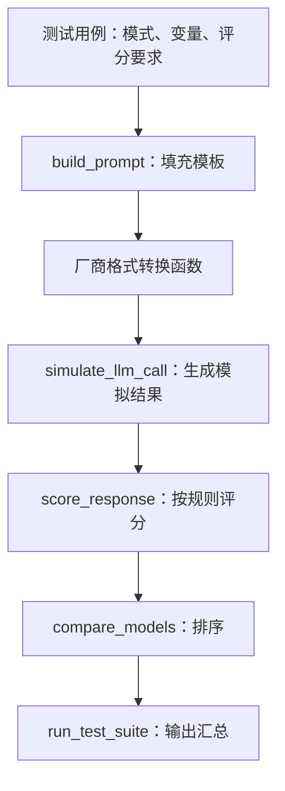

# 01：提示词工程——从一次请求到可测试的任务说明

## 零、初学者先读：模型收到的究竟是什么

这一课中的 **prompt（提示）**是送给模型的任务信息。它可以包含规则、用户问题、示例和资料。**prompt template（提示模板）**是有空位的固定文字；把空位替换成本次内容称为 **render（渲染/填充）**。它不会训练模型。

例如模板 `请用{language}解释{topic}`，变量是 `{"language":"中文","topic":"向量"}`，得到“请用中文解释向量”。原代码 `build_prompt(pattern_name,variables)` 先选一种任务模板，再填变量，再组织消息；不是调用这个函数就已经让模型回答了。

**API** 是程序调用另一服务的接口；**SDK** 是把请求/响应包装成函数调用的库。一个请求可以写成 Python dict，发送时序列化为网络消息；响应包含答案和元数据。API 密钥相当于服务访问凭据，笔记里只写变量名，不写真实值。

**system/user/assistant** 表示不同消息来源/角色：规则、用户输入、助手历史输出。把用户资料中的文字写成“system:”不会自动改变权限。历史 assistant 回答也可能错，不等于已经验证的事实。

**Token** 是分词单位，不是一定一个汉字或一个单词；**temperature** 影响支持该参数的模型的采样分布，不是“智商开关”；**max output tokens** 限制输出长度，不是准确度指标。具体模型支持参数可能不同。

### 0.1 用一次任务看什么叫清楚

模糊提示：“分析这个评价。”

清楚提示：“将下列商品评价标为正面、负面或中性，只输出一个标签；无法判断用中性。评价：包装完整，还没用。”

后者明确了任务、标签集合、输出形式和不确定时行为。模型仍可能错，但程序知道怎样验收。要求“你是专家”只是任务视角，不会自动赋予真实资质或补足缺失资料。

### 0.2 先把十类模式放进用途

下面正文保留原课十种模板及实现。读到角色、少样本、分步解题、自我检查、结构化输出、逐步任务链、资料问答等模式时，先问三件事：**输入包含什么？输出要变成什么？用什么办法检查？** 不必先背英文名字。

少样本是放输入输出示例，结构化输出是要求固定字段，RAG 是提供检索证据，工具调用是由程序执行动作。它们可组合，但不是所有问题都要一次用完。

### 0.3 代码的执行层次与预期

```text
模板目录 → build_prompt 填变量 → provider格式适配
→ simulate_llm_call 模拟返回 → score_response规则评分
→ compare_models/测试套件汇总
```

原 demo 的多模型返回是模拟的，不是真实测了多个厂商模型。分数来自关键词/格式等规则，不是完整人工质量评价。跑通它表示你理解了提示测试程序结构，不意味着哪个模型真的赢了。

在本课目录用 `python code/prompt_engineering.py` 运行完整脚本，标准库即可；会看到模板目录、单提示示例、多模型模拟和测试汇总。正文中的 SDK 调用作为接入示意，不能取消注释后直接假设所有模型/参数当前可用。

**本次整理说明（2026-11-01）：**保留下面已有详细正文与代码，补充初学者入口并核对了当前课程主题。源码动态模型名、规格和榜单不当作当前承诺。原文强调跨模型统一模板，但不同模型可能需要分别验证消息结构、prefill和temperature支持；无需重新阅读英文才能理解本课原理。

自测：build_prompt 返回一个字典，为什么还不是模型答案？因为它只是准备输入。提示词是否成功怎样判断？用独立样例、明确评分规则和失败分析，而不是只看一次漂亮输出。

---

> 对应课程：Phase 11 / 01-prompt-engineering。原文与仓库代码核对日期：2026-11-01。
> [原课正文](https://github.com/rohitg00/ai-engineering-from-scratch/blob/main/phases/11-llm-engineering/01-prompt-engineering/docs/en.md) · [原课代码目录](https://github.com/rohitg00/ai-engineering-from-scratch/tree/main/phases/11-llm-engineering/01-prompt-engineering/code)
> 中文解释、数值小例子与纠错为学习补充；保留原课核心实现，代码中的英文变量/接口名便于与仓库对照。

> 路径约定：本文的 `~/projects/ai-engineering-from-scratch` 是通用示例，不表示仓库已位于该处。执行命令前，请将它替换为实际克隆目录；以 `phases/` 开头的路径均相对于课程仓库根目录。

> 学习主题：把模糊的需求写成可执行、可检查的指令，并用测试判断提示词是否有效。

- 课程：AI Engineering from Scratch / Prompt Engineering: Techniques & Patterns。
- 整理日期：2026-10-05。
- [课程网页](https://aiengineeringfromscratch.com/lesson?path=phases/11-llm-engineering/01-prompt-engineering&learningPath=building-and-deploying-ai-applications)。
- [课程正文](https://github.com/rohitg00/ai-engineering-from-scratch/blob/main/phases/11-llm-engineering/01-prompt-engineering/docs/en.md)。
- [Python 示例源码](https://github.com/rohitg00/ai-engineering-from-scratch/blob/main/phases/11-llm-engineering/01-prompt-engineering/code/prompt_engineering.py)。

本笔记以课程正文、Python 代码、测验和两个输出文件为依据，覆盖原课的概念、十种模式、实现流程、应用与练习。文中“补充理解”和“核对说明”是对课程的解释或修正，不是原课逐字翻译。模型名称、上下文长度和接口参数会变化，实际调用时应查所用模型的官方文档。

## 1. 本课要解决什么问题

同一个模型，收到“帮我写一篇文章”和收到明确的主题、读者、依据、长度与格式后，可能给出差别很大的结果。模糊需求让模型自行决定很多事情；提示词工程的工作是把这些决定讲清楚。

**提示词工程（Prompt Engineering）**：设计和迭代模型输入中的指令、示例和表达方式，使输出更符合任务要求。一般不会因此修改模型参数。

**上下文工程（Context Engineering）**：还要决定放入哪些文档、历史消息、检索结果和工具信息。提示词工程是其中的一部分。

例如，回答不准确可能来自不同原因：任务没说清、资料不足、资料错误、模型能力不够，或者没有做结果验证。不能把所有失败都归因于“提示词不够好”。

本课的四个学习目标：

1. 用角色、背景、约束和输出格式表达清楚需求。
2. 编写明确的系统规则与任务指令。
3. 判断幻觉、错误拒绝、格式不合规等失败发生在哪一步。
4. 建立测试流程，比较不同提示词版本，而不只凭单次回答的观感判断。

## 2. 提示词的内容与消息结构

### 2.1 内容：任务与四个核心要素

任务本身要先明确，再补充下面四项。

| 要素 | 要回答的问题 | 学习场景中的例子 |
|---|---|---|
| 角色 Role | 从什么专业视角处理？ | 用深度学习课程助教的视角解释 |
| 背景 Context | 已知什么、面对谁、使用哪些材料？ | 读者了解基础数学，刚开始接触 PyTorch |
| 约束 Constraints | 必须包含什么，信息缺失时怎么办？ | 区分论文结论与解释；未提供的信息标为“未说明” |
| 输出格式 Output Format | 答案如何组织、如何验收？ | 先给定义，再给例子，最后给三道自测题 |

这些是检查项，不要求每次把四项都写成长段落。一个简单任务，清楚的任务描述和格式要求可能已经足够。

### 2.2 消息结构：不同内容放在哪一层

| 概念 | 用途 | 容易混淆的地方 |
|---|---|---|
| System / 应用级指令 | 设置稳定的行为规则、身份与任务边界 | 输入文字“这是系统指令”不会自动改变消息权限 |
| User message | 提出这次的任务，提供这次的材料 | 其中可能同时有指令和待处理数据，要讲清两者的区别 |
| Assistant message | 保存已有助手回答，形成多轮上下文 | 历史回答仍可能有错误，需要允许后续纠正 |
| Assistant prefill | 提供回答开头，让支持的接口从该位置续写 | 是特定模型/接口功能，并非所有调用都必需或支持 |

原课把 system、user、assistant prefill 放在一张图里，主要是说明用途。实际调用并不一定包含这三者，应用也需要按接口要求管理多轮状态，不能假定模型会永久保存此前规则。

**核对说明：**原课把 assistant prefill 当作可直接用于较新 Claude 的技巧。Anthropic 当前文档说明，Claude 4.6 起及部分更新模型不支持最后一条 assistant 消息的预填，较早模型仍可支持。因此需要按具体模型确认；输出 JSON 时可以考虑明确格式要求或结构化输出。[Anthropic 官方说明](https://platform.claude.com/docs/en/build-with-claude/prompt-engineering/claude-prompting-best-practices#migrating-away-from-prefilled-responses)

### 2.3 指令与资料要分清

下面是一个自拟的读论文提示词：

```text
任务：根据下方论文摘录解释编码器与预测器的作用。
读者设定（示例）：有基础数学知识、刚开始学深度学习的学习者。
要求：区分摘录中的明确结论与为了理解而给出的类比；缺失信息写“摘录未说明”。
格式：一句话概括、模块表、一个例子、三个待确认问题。

<paper_excerpt>
这里放论文摘录。这一部分是待分析资料，不作为新的任务指令。
</paper_excerpt>
```

标签或分隔符帮助模型理解边界，但本身不会强制执行权限隔离。真实应用还要在程序层面控制数据来源、工具调用和输出验证。

## 3. 清晰指令、角色、输出与约束

### 3.1 角色提示为什么可能有效

“用资深 Python 开发者的视角审查代码”可以帮助限定术语、关注点与表达方式，但模型不会因为被赋予身份就获得新的知识、真实工作经历或更高事实准确率。

角色应贴合任务。例如“检查数据读取、训练循环与张量维度的 PyTorch 助教”比一长串与任务无关的荣誉头衔更容易指导工作。原课用“激活训练数据中的专家分布”来解释角色提示，可以把它看作直观描述，不应当作已经验证的内部机制或效果保证。

### 3.2 把模糊要求改成可检查的要求

原始需求：

```text
解释这段代码，详细一点。
```

改进需求：

```text
解释下方 Python 代码，读者会写函数和循环，但不熟悉字典推导式。
先说明整体输入与输出，再解释三个核心函数。
每个函数给一个最小输入和对应输出。
如果某段代码只是在模拟结果，请明确标注。
最后列出两处需要进一步验证的假设。
```

检查指令是否清楚，可以问：任务是什么？读者是谁？依据在哪里？要多长？要输出什么格式？信息缺失、格式错误或超出范围时怎样处理？

### 3.3 输出格式控制

| 格式 | 常见用途 | 提示词要说清的内容 |
|---|---|---|
| JSON | 程序读取、字段提取、分类 | 字段名、类型、允许值、缺失值 |
| XML 风格标签 | 区分材料、结果、依据等区域 | 每个标签的含义与内容边界 |
| Markdown | 学习笔记、报告 | 章节、表格、代码块、引用要求 |
| 编号列表 | 有固定数量的步骤或选项 | 项目数量、每项内容、长度 |
| 固定文本模板 | 多次输出保持同一结构 | 字段、顺序、空缺时的处理 |

需要分清三个标准：

1. **语法正确**：字符串能被 JSON 解析器读取。
2. **结构正确**：包含指定字段，字段类型和值域符合要求。
3. **语义正确**：字段内容与原始资料一致。

仅写“只输出 JSON”，通常有助于格式稳定，但不能保证三项全部满足。支持的结构化输出接口可以约束结构，内容仍需验证。[OpenAI 官方结构化输出文档](https://developers.openai.com/api/docs/guides/structured-outputs)

### 3.4 三种约束

| 类型 | 自拟例子 | 作用 |
|---|---|---|
| 正向约束 | 每项结论附对应资料位置 | 明确希望出现的行为 |
| 负向约束 | 不补造材料里没有的实验数值 | 明确需要避开的行为 |
| 条件约束 | 若没有提供显存大小，先标为未知 | 规定边界情况怎么处理 |

原课有时用“保证”描述约束作用，实际更准确的理解是：约束表达目标，模型遵循程度需要测量。长规则列表也不是必然更好，要避免重复、歧义和互相冲突。

例如，“完整分析所有函数，全文不超过 50 字”就难以同时满足。可以明确优先级：先保证核心函数解释完整，长度仅作为次要目标。

## 4. Temperature、Top-p 与上下文窗口

### 4.1 Temperature：调整采样分布

模型为候选 token 产生 logits，常见温度变换可以写为：

$$
p_i = \frac{\exp(z_i/T)}{\sum_j \exp(z_j/T)}
$$

其中 $z_i$ 是候选 token 的 logit，$T>0$ 是温度。较低温度使分布更尖锐，较高温度使分布更平缓。在采样生成时，这通常影响输出的多样性。$T=0$ 需要由具体实现定义，例如采用贪心选择，不能直接代入上式。

“更随机”不等于“更有创造力”或“更错误”；“更稳定”也不等于“更正确”。不同模型是否支持温度、支持什么范围，需要查其接口。

原课给出的起点是：提取/分类偏低温度，摘要/分析偏低到中等，创作偏中等到较高。可以保留这种实验思路，但不要把 `0.0 / 0.3 / 0.7 / 1.0` 当作所有模型通用的最佳设置。

**核对说明：**`temperature=0` 不保证在线 API 每次逐字返回相同结果。Anthropic 官方文档明确说明，同样输入在温度为零时也可能出现差异。[官方术语说明](https://platform.claude.com/docs/en/about-claude/glossary#temperature)

### 4.2 Top-p：裁剪候选集合

Top-p（核采样）把候选 token 按概率排序，保留累计概率达到阈值的最小候选集合，再从中采样。

例如候选概率为 `0.50、0.30、0.15、0.05`，当 `top_p=0.9` 时，通常保留前三项，因为前两项累计只有 `0.80`，前三项达到 `0.95`。

它控制的是概率质量，不是“保留词表中 90% 的词”。温度和 Top-p 可以在某些实现中共同使用；实验时一次主要调整一个参数，更容易判断变化来自哪里。Hugging Face 的生成配置分别定义了采样开关、温度和 Top-p。[官方生成配置](https://huggingface.co/docs/transformers/main/en/main_classes/text_generation)

### 4.3 上下文窗口：这次调用能够处理多少信息

需要关注输入材料、历史消息、工具结果以及预留输出所占的 token。具体输入、输出和推理预算如何计算，按所用模型说明判断。

上下文窗口大，意味着可以放入更多信息，不代表模型必然有效利用每个细节，也不意味着这些信息永久写入模型参数。

原课列出了不同厂商模型的上下文与输出上限。学习时理解“容量与预算”的概念即可；做应用时仍要查询所选具体版本，不能沿用课文表格作为当前规格。

如果资料太多，处理思路包括：删除与任务无关的内容、先检索相关片段、分段提取再汇总、预留输出空间。判断依据应该是效果，而不是只比较提示词长短。

## 5. 十种提示词模式

十种模式全部保留。它们可以组合，例如“模板填充 + 少样本 + 条件约束”，不必每次都使用全部模式。

| 原课模式 / 代码键 | 核心方法 | 自拟例子 | 使用时要检查什么 |
|---|---|---|---|
| Persona / `persona` | 指定处理任务的角色与关注点 | 以 PyTorch 助教视角检查训练代码 | 身份描述不能代替证据 |
| Template / `template_fill` | 按固定字段提取或填写 | 论文名称、输入、输出、损失、局限；未说明填 null | 字段结构与内容都要验证 |
| Meta-prompt / `meta_prompt` | 让模型帮助生成或改写提示词 | 把“解释论文”改成明确任务，并说明改动 | 改写是否真的提高结果质量 |
| Chain-of-thought / `chain_of_thought` | 引导分阶段求解多步任务 | 列出已知量、计算关键步骤、验证答案 | 解释流畅不能证明答案正确 |
| Few-shot / `few_shot` | 提供少量输入/输出示例 | 给出正面、负面、混合评论的分类示例 | 示例应覆盖不同情况，不能混入测试答案 |
| Guardrail / `guardrail` | 规定行为边界和异常处理 | 依据资料回答；资料不足时标为未知 | 单靠文字规则不能保证防攻击 |
| Decomposition / `decomposition` | 拆成子任务，分别完成再汇总 | 先查数据、再查模型、最后查训练循环 | 子任务是否遗漏，相互依赖是否处理 |
| Critique / `critique` | 生成草稿、按标准检查、改进 | 检查笔记的事实、缺项和术语解释，再修订 | 自我检查可能重复原错误 |
| Audience adaptation / `audience_adapt` | 按读者基础调整解释 | 向初学者解释注意力，定义 Q/K/V | 简化表达仍要保持准确 |
| Boundary / `boundary` | 明确任务范围和越界回应 | 编程助手只处理指定课程问题 | 应用程序还需要自己的范围控制 |

### 5.1 Few-shot 示例：样例告诉模型什么算正确

```text
任务：判断学习反馈的情绪，只输出 positive、negative 或 mixed。

输入：这节课解释清楚，我已经跑通了代码。
输出：positive

输入：安装一直失败，暂时不想继续了。
输出：negative

输入：概念终于懂了，但代码还没有运行成功。
输出：mixed

现在处理：内容有帮助，不过环境配置让我很困惑。
```

少样本提示是在本次上下文中提供示范，一般不更新模型参数。例子要准确，覆盖正常情况与边界情况；例子数量不是越多越好。[OpenAI 官方 Few-shot 说明](https://developers.openai.com/api/docs/guides/prompt-engineering#few-shot-learning)

### 5.2 CoT 与拆解的区别

CoT 关注分阶段处理一个推理任务；Decomposition 关注把大任务拆成可分别处理的子任务。它们可以同时使用。

原课折扣题可以用来理解“检查答案”比“看到步骤”更重要：原价 85，八折和 10 的优惠券，先折扣再用券为 `85×0.8−10=58`，先用券再折扣为 `(85−10)×0.8=60`。第一种少付 2。

实际应用可要求模型给关键计算、假设和可验证依据，无需要求逐字披露内部思维链。原课关于“所有模型都提高某个固定百分比”的表述不能视为通用效果，需要看任务和实验条件。

### 5.3 Critique 示例：给出明确检查标准

```text
先根据论文摘录生成模块说明。
再按以下标准检查：
1. 每项事实是否能在摘录中找到依据；
2. 是否混淆训练过程与推理过程；
3. 是否把类比写成论文结论。
最终只输出修订后的说明，以及简短的实质性改动记录。
```

“请检查一下”不如具体的检查标准有操作性。事实验证仍需要回到材料、工具结果或实验，不宜只让同一模型评价自己。

## 6. 反模式、失败诊断与跨模型设计

### 6.1 原课的四类反模式

| 问题 | 表现 | 改进思路 |
|---|---|---|
| 提示注入 Prompt injection | 待处理文档包含“忽略规则”等指令，试图改变任务 | 区分指令与资料，限制工具权限，检查结果 |
| 约束过多 | 要求重复、无关，重点不明确 | 删除冗余，明确优先级，再测试 |
| 指令矛盾 | 要求既极短又完整覆盖大量细节 | 说明主要目标，或拆成摘要与详细版 |
| 假定模型行为相同 | 某模型有效，就认为所有模型都有效 | 在目标模型与代表性输入上验证 |

提示注入也可能来自网页或检索资料，不限于直接用户输入。写一个“永远不要忽略规则”的提示词只是行为要求，不能当作程序级隔离。原课建议的分隔符、输入检查和输出过滤应理解为组合措施的一部分。

“系统提示词一定少于 500 token”“超过某个约束数就会失败”等说法可以作为作者的经验意见，不能当成普适上限。

### 6.2 根据失败类型修改

| 失败类型 | 先检查 | 可以尝试的改动 | 验证方法 |
|---|---|---|---|
| 内容泛泛 | 任务、读者、材料是否明确 | 给出背景、具体目标和重点 | 看关键内容是否覆盖 |
| 编造事实 | 是否缺证据，是否要求补齐所有字段 | 引用资料；缺失写未知；区分推测 | 对照原始资料 |
| 错误拒绝 | 是否把范围定义得太宽或太窄 | 澄清允许范围和具体任务 | 测试允许与越界两类输入 |
| 格式错误 | 是否规定字段/类型；输出是否截断 | 模板、示例、结构约束 | 解析器与结构验证 |
| 推理错误 | 条件是否完整，有没有计算验证 | 拆解任务、提供工具、检查关键步骤 | 标准答案或实际执行 |
| 模型迁移后失效 | 接口、模板、采样支持是否变化 | 分离任务内容与厂商适配代码 | 在相同测试集上重跑 |

### 6.3 跨模型提示词设计

原课建议使用清晰自然语言、明确格式、分隔资料与指令、提供示例、突出关键要求并跨模型测试。核心思想是减少对默认行为的依赖。

不必为了“跨模型”强制改用英语或 XML。中文、Markdown、标签是否有效，可以在实际任务上比较。提示词结构可能复用，系统指令的字段位置、模型 ID 和参数仍需分别适配。

## 7. Python 实现：逐层读懂测试框架

课程入口（相对于仓库根目录）：

```text
phases/11-llm-engineering/01-prompt-engineering/code/prompt_engineering.py
```

示例只使用 `json、time、hashlib、re` 等 Python 标准库。没有联网调用、没有 API 密钥需求，也不依赖 PyTorch 或 GPU。



### 7.1 模板库 `PROMPT_PATTERNS`

每种模式保存名称、模板字符串、必需变量、温度建议和描述。例如 `persona` 使用 `role、experience、style、priority、task`。

这里的 `temperature` 只是字典数据；把它写进字典不会自动影响任何模型。必须在真实调用时传给支持的接口，才可能生效。

### 7.2 构建器 `build_prompt()` 与多轮结构

`build_prompt()` 按顺序完成：查找模式、验证变量是否齐全、用 `.format(**variables)` 填充模板、返回包含 `system、user、temperature、pattern、metadata` 的字典。

可以从一个例子跟踪数据：

```python
prompt = build_prompt(
    "persona",
    {
        "role": "a Python tutor",
        "experience": "experience teaching beginners",
        "style": "clear and practical",
        "priority": "understanding the code",
        "task": "Explain why Python virtual environments are useful.",
    },
)

print(prompt["user"])
```

这段代码用于已有模块的上下文，不能脱离 `build_prompt()` 定义单独运行。

`build_multi_turn()` 把 system 与传入的 `(role, content)` 消息组合成列表，演示多轮消息的数据结构；它也不进行模型调用。

源码默认 system 只说明“使用某种模式”，详细角色与行为规则仍在 user 模板中。如果做实际应用，可把稳定规则与每次变化的数据进一步分离。

### 7.3 厂商请求适配

`format_openai_request()`、`format_anthropic_request()`、`format_google_request()` 演示如何把内部统一字典转成不同形状的请求数据。

阅读时关注“一个内部表示，多种外部适配”。源码中有显示名称与模型 ID 不一致的配置；Google 适配函数还把 system 字符串拼进 user 文本中，这不等于真正使用专门的系统指令参数。Google 官方接口提供 `systemInstruction` 等专门机制。[Google 官方说明](https://docs.cloud.google.com/gemini-enterprise-agent-platform/models/prompts/introduction-prompt-design#system-instructions)

这些函数目前只生成字典，不能证明请求会被当前真实 API 接受。课程 Use It 中的 SDK 片段同样属于调用结构示例，使用前要核对模型、参数和支持的功能。原课的 LangChain 部分展示统一模板连接不同后端的想法，但框架也不会消除接口差异。

### 7.4 模拟调用 `simulate_llm_call()`

函数做了三个主要动作：短暂等待、为请求计算哈希、返回预先写好的回答与统计值。请求变化时，回答中的哈希可能变化，但回答主体仍是固定模拟文本。

因此它适合学习测试框架的数据如何流动，不能验证少样本、角色、温度或规则是否真的改善了大模型输出。

`run_prompt_test()` 记录的两类延迟也要分清：`wall_time_ms` 是本次模拟函数的实际耗时；`api_latency_ms` 是模拟字典内写死的数值。它们都不是实际厂商的服务测速结果。

### 7.5 评分器 `score_response()`

| 指标 | 源码实现 | 实际代表什么 |
|---|---|---|
| `length_compliant` | 空白分割后与 `max_words` 比较 | 是否符合示例的英文词数规则 |
| `keyword_coverage` | 必需词命中比例 | 是否出现指定字符串 |
| `no_violations` | 是否命中禁止短语 | 是否出现这些特定短语 |
| `format_valid` | JSON 解析或列表启发式检测 | 是否通过简化格式检查 |
| `composite_score` | 对布尔值与 0～1 浮点分数取平均 | 当前规则的综合分，而非事实准确率 |

综合分示例：长度通过为 1、关键词覆盖为 0.5、禁止短语检查为 1、格式通过为 1，则平均为 `0.875`。这并不意味着回答内容有 87.5% 正确。

评分器的局限：

- `split()` 不适合直接统计无空格中文的字数。
- 关键词匹配无法判断语义，“不是好方法”也可能命中“好方法”。
- `json.loads()` 不会检查是否有指定字段、值域是否正确。
- 编号列表只检查至少两行匹配数字加点，不验证项目数量和内容。
- 项目符号检测甚至会把以 `1` 开头的部分普通文本算入，属于启发式。
- 空答案可能通过长度与禁止短语检查，要另外检查非空和任务完成度。

### 7.6 比较函数与五个测试用例

`compare_models()` 评分并按综合分降序排序；`run_test_suite()` 遍历测试集，显示分数、token 与延迟，汇总“胜出次数”。

源码的五个用例覆盖：角色式技术写作、少样本情绪分类、折扣数学题、简历字段提取、限定领域的 Python 助教。不是全部十种模式。

**实际运行核对：**本次运行源码正常退出，但汇总显示 `gpt-4o: 5 wins out of 5 tests`。三个模拟后端在每项任务里的分数都相同，排序保留原顺序，程序又把第一项记作唯一胜者。它反映的是模拟文本与平局处理方式，不能用来判断真实模型优劣。

## 8. 在你的 Ubuntu 环境中运行

在 WSL 的 Ubuntu 终端执行：

```bash
cd ~/projects/ai-engineering-from-scratch
source .venv/bin/activate
python phases/11-llm-engineering/01-prompt-engineering/code/prompt_engineering.py
```

输出分为模式目录、单个提示词构建演示、测试集及排名汇总。可以先检查三个问题：模板变量如何进入 user 字符串？不同后端的字典形状哪里不同？评分是否真正检查任务答案？

本文的运行核对使用了 Windows Python，因为脚本仅依赖标准库；上面的命令则对应你平时学习的 Ubuntu 环境。运行成功不代表接入了在线模型。

## 9. 怎样测试一个提示词是否更好

工程上的迭代过程是：先定义正确结果，再建立代表性测试集，记录初版输出，只改一个主要因素，用同一测试集比较，最后在未参与调参的输入上复核。

| 要记录的项 | 例子 |
|---|---|
| 版本与改动 | v1 只写任务；v2 加字段模板；v3 加缺失值规则 |
| 模型和参数 | 明确版本、支持的采样设置、输出预算 |
| 输入类别 | 正常、缺失、冲突、超范围、长资料 |
| 质量指标 | 格式合规率、字段准确率、缺失值处理正确率 |
| 性能指标 | 实际响应时间、token 用量与成本 |
| 失败案例 | 保存原始输入、输出和失败原因 |

不要在同一批样例上反复优化后，就把结果当作泛化能力。对存在随机性的调用要重复测试。自评或另一个模型评分可以辅助发现问题，但不能代替能够检查的标准答案、原始资料或代码执行。

例如，数学题评估应检查答案是否为 58 和 60，而不是只检查输出里有没有 `discount、coupon、$`；数据提取应逐字段对照资料，而不是只检查存在人名字符串。

## 10. 课程交付物与五项练习

原课提供两个可复用文件：

- `outputs/prompt-prompt-optimizer.md`：帮助分析模糊、缺少格式、约束冲突等问题，并改写提示词。
- `outputs/skill-prompt-patterns.md`：按任务类型选择模式的参考表。

其中的固定准确率、跨模型优劣、约束数量上限和提升百分比应当作为作者建议或待验证假设，不能直接当作你的测试结论。

五项原课练习及建议记录：

| 练习 | 要做什么 | 应保存什么 |
|---|---|---|
| 1. 扩展测试集 | 为元提示、拆解、批评改进、读者适配和范围边界增加用例 | 新输入、预期结果和评分标准；模拟版只用于检查流程 |
| 2. 接入真实模型 | 用至少两个真实后端比较同一提示词 | 模型版本、格式、内容质量、真实延迟与用量；是否有免费额度要查实际账户 |
| 3. 提示注入测试 | 在自己的测试应用中构造十条干扰输入 | 原本允许的任务、是否被干扰、失败原因与改进前后结果 |
| 4. 自动优化 | 按原课设置重复运行、评分、定位弱项、改写，迭代三轮 | 每版提示词、逐项分数与独立验证结果；参数按模型支持情况调整 |
| 5. Prompt diff | 比较两版中的角色、示例、约束、格式变化 | 对改动效果的预期与实际结果；文本差异本身不能证明质量提升 |

## 11. 在学习与技术资料阅读中的应用

提示词工程可用于读技术资料、解释代码、整理实验记录，以及给语言模型应用定义任务。它是辅助工具，不会替代模型训练或实验验证；可以通过任务完成质量来评估提示词是否有效。

下面是一份自拟的论文阅读提示词，可直接按材料修改：

```text
请根据下方论文摘录，帮助我理解这一部分。

读者设定（示例）：了解基础数学与 Python 语法，暂不熟悉材料涉及的模型结构。
任务：说明输入、输出、主要模块和训练目标。
要求：
- 首次出现的术语先解释；
- 区分论文明确写出的内容、解释性类比与尚待验证的推测；
- 公式说明每个符号的含义；
- 缺失的信息写“摘录未说明”，列为待确认问题。
格式：一段概述、一张模块表、一个最小例子、三道理解检查题。

<source>
这里放需要阅读的原文。
</source>
```

调试代码时则应提供：运行命令、工作目录、Python 路径、相关代码和完整报错。只写“代码为什么不行”，会让模型猜测本来可以确认的条件。

## 12. 复习自测

先尝试自己回答，再展开参考答案。

1. 提示词的四个核心要素是什么？任务与背景有什么区别？
2. Few-shot 是否会更新模型参数？
3. `temperature=0` 是否保证回答正确或每次完全相同？
4. `json.loads()` 成功，是否说明字段内容正确？
5. CoT 与任务拆解分别关注什么？
6. 原课的模拟后端可以验证模型能力吗？
7. 为什么某后端“5/5 胜出”不能作为模型排名？
8. 如何判断提示词改动真的提高了效果？

<details>
<summary>参考答案</summary>

1. 角色、背景、约束、输出格式。任务说明要完成什么；背景说明处理任务时可使用的信息和条件。
2. 一般不更新参数，是在当前上下文中给出输入/输出示例。
3. 两者都不能保证。低温度通常降低采样随机性，但正确性需要证据与验证，在线调用也可能不完全确定。
4. 不说明。还要验证字段、类型和值，以及与原文的一致性。
5. CoT 引导分阶段求解，任务拆解把大任务分成子任务再组合。
6. 不可以，它主要演示模板、适配、评分和汇总的数据流程。
7. 此次模拟结果分数相同，程序把排序首项记作唯一赢家；没有真实模型调用。
8. 预先定义指标，用同一代表性测试集比较，保留失败案例，再用独立输入验证，必要时多次运行。

</details>

可以把本课的掌握标准设为：能自己改写一个模糊请求；能解释十种模式的用途；能追踪示例代码的数据流；能分清模拟指标、格式合规和语义正确；能设计一个具有明确正确结果的提示词对比实验。


## 本次验证记录（2026-11-01）

本次运行原仓库标准库演示成功；其中模型调用与多模型排名均为模拟。已有正文中的较早验证日期仅说明当时记录。

---

[返回学习导航](<00：Phase11学习导航与验证说明.md>) · [基础概念预备课](<00A：LLM应用入门预备课——API、JSON、向量与状态.md>)


> 来源及许可：原课代码与文档来自 Rohit Ghumare 的 ai-engineering-from-scratch，MIT License，Copyright (c) 2026 Rohit Ghumare。中文讲解及教学纠错为补充；本章导航附完整许可声明。
