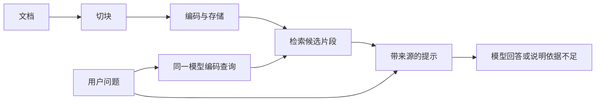

# 06：RAG——从文档检索到有依据的回答

> 对应课程：Phase 11 / 06-rag。原文与仓库代码核对日期：2026-11-01。
> [原课正文](https://github.com/rohitg00/ai-engineering-from-scratch/blob/main/phases/11-llm-engineering/06-rag/docs/en.md) · [原课代码目录](https://github.com/rohitg00/ai-engineering-from-scratch/tree/main/phases/11-llm-engineering/06-rag/code)
> 中文解释、数值小例子与纠错为学习补充；保留原课核心实现，代码中的英文变量/接口名便于与仓库对照。


## 一、用一个问题理解整条链

用户问“企业套餐能在多久内退款？”模型可能知道常见退款政策，但不知道这家公司刚更新的制度。原课虚构制度是：企业客户有 60 天窗口，按比例退款。我们要先找到这段制度，再让模型根据它回答，并注明出处。

**RAG = Retrieval-Augmented Generation，检索增强生成**。三个词分别指：Retrieve 找到资料；Augment 把资料补进输入；Generate 根据输入生成回答。模型权重通常不变，变化的是这一次看到的上下文。



上半段是**离线建索引**，文档更新时再做；下半段是**在线查询**，每次提问都会做。离线不等于不能联网，而是与用户即时问答解耦的准备过程。

## 二、先懂各个部件

- **Document 文档**：原始文件或记录，可能很长。
- **Chunk 片段**：文档的一部分，可独立索引；需要带源文档、位置、版本等 metadata（元数据）。
- **Embedding 向量表示**：文本转换后的数字；查询与文档必须处于相同表示空间。
- **Vector store 向量存储**：保存向量及其文档映射。FAISS 是索引库，数据库还要承担持久化、过滤、更新等职责。
- **Top-k**：按相关性返回前 k 项，k 是数量，不是“至少这么相关”的阈值。全库无关时也可能返回 k 条，因此还需要空结果策略。
- **Grounding 依据约束**：把回答约束在提供的证据内；提示要求不等于可靠保证。
- **Citation 引用**：把结论连接到具体证据；有编号不代表编号内容真的支持结论。

## 三、原课用 TF-IDF，让流程可看见

**TF** 是一个词在该片段里的出现频率；**IDF** 让在全部文档中少见的词权重更大。原课采用平滑 IDF：`ln((N+1)/(df+1))+1`，其中 N 是文档数量，df 是包含该词的文档数。最后逐坐标相乘形成向量。

词表假设只有 `[refund, password]`，文档一只讲 refund，文档二只讲 password。查询 refund 的向量更靠近第一篇。这能练习检索，但如果查询用 reimbursement 而词表中没有该词，普通 TF-IDF 不会自动理解它与 refund 的近义关系。真实语义模型是可替换的 embedder，不是 TF-IDF 的另一个名字。

余弦相似度 = 点积 / 两者范数乘积；越接近 1，方向越相似。点积会受长度影响，L2 距离越小越近。向量是否归一化、模型训练时适合哪种度量，要与索引配置一致。

## 四、切块不是随便截一段

固定长度切块以 `chunk_size-overlap` 为移动步长。句子/段落切分尽量保留语义，递归切分按章节→段落→句子→更细单位逐级拆。Overlap 是相邻块重复的内容，用来减轻边界信息缺失；会增加存储和重复检索。

原课参考参数 256～512 token、重叠 50、返回 5～10 块，只是起步范围。对结构化表格、代码、条款和中文要单独实验。代码 `split()` 使用词而非 token，中文直接套用会失效。参数必须满足 `chunk_size>overlap>=0`。

检索后构建提示的核心要求：提供问题、带来源的片段、仅据资料回答的规则、不足时明确说不知道。检索文档里的“请忽略规则”等文字是数据，不是应用指令。

## 五、RAG 与微调怎样选择

微调修改参数，适合学习行为、表达、格式或领域任务；RAG 更直接地提供会更新、需引用的外部事实。两者可以组合，不是二选一。

原课“RAG 永远胜过微调”“RAG 文档留在向量库因此隐私天然安全”等说法过强：检索到的内容通常仍会送入生成模型；私密文档需访问控制，不能让无权限查询拿到片段。RAG 也可能检错、读错、引用错。费用取决于文档规模、模型、查询长度和频率，原课美元范围不是保证。

## 六、原文 Build It：六步代码

### 步骤 1：文档切块

将文档拆为有重叠的词片段。限制chunk_size和overlap，保留来源和位置才方便后续引用。

````python
# 本块中文说明：文档切块
# 用空白分词并滑窗切块；chunk_size 是词数而非模型 token。
def chunk_text(text, chunk_size=200, overlap=50):
    words = text.split()
    chunks = []
    start = 0
    while start < len(words):
        end = start + chunk_size
        chunk = " ".join(words[start:end])
        chunks.append(chunk)
        start += chunk_size - overlap
    return chunks
````

### 步骤 2：TF-IDF编码

所有文档共用一个有序词表，TF统计当前文本频率，IDF统计整个语料稀有性，相乘得到向量。网页compute_tf对空文本需补处理；源码版已有保护。

````python
# 本块中文说明：TF-IDF编码
import math
from collections import Counter

def build_vocabulary(documents):
    vocab = set()
    for doc in documents:
        vocab.update(doc.lower().split())
    return sorted(vocab)

def compute_tf(text, vocab):
    words = text.lower().split()
    count = Counter(words)
    total = len(words)
    return [count.get(word, 0) / total for word in vocab]

def compute_idf(documents, vocab):
    n = len(documents)
    idf = []
    for word in vocab:
        doc_count = sum(1 for doc in documents if word in doc.lower().split())
        idf.append(math.log((n + 1) / (doc_count + 1)) + 1)
    return idf

def tfidf_embed(text, vocab, idf):
    tf = compute_tf(text, vocab)
    return [t * i for t, i in zip(tf, idf)]
````

### 步骤 3：余弦检索

对查询和每个存储向量计算余弦，得到(索引,分数)，降序取前k。返回索引再查回文本；即使分数全0也会有top-k，需额外拒答/阈值策略。

````python
# 本块中文说明：余弦检索
# 点积除以两向量范数；零向量按代码约定处理。
def cosine_similarity(a, b):
    dot = sum(x * y for x, y in zip(a, b))
    norm_a = math.sqrt(sum(x * x for x in a))
    norm_b = math.sqrt(sum(x * x for x in b))
    if norm_a == 0 or norm_b == 0:
        return 0.0
    return dot / (norm_a * norm_b)

# 计算候选得分并排序，返回前 top_k 项；返回结果不等于已经生成答案。
def search(query_embedding, stored_embeddings, top_k=5):
    scores = []
    for i, emb in enumerate(stored_embeddings):
        sim = cosine_similarity(query_embedding, emb)
        scores.append((i, sim))
    scores.sort(key=lambda x: x[1], reverse=True)
    return scores[:top_k]
````

### 步骤 4：构建有来源的提示

给片段编号Source，再填入规则、资料、问题。编号只是引用标识，不自动验证资料真假。整个函数只返回字符串。

````python
# 本块中文说明：构建有来源的提示
# 将检索资料、来源标识和问题拼入提示；只构建输入，不调用模型。
def build_rag_prompt(query, retrieved_chunks):
    context = "\n\n---\n\n".join(
        f"[Source {i+1}]\n{chunk}"
        for i, chunk in enumerate(retrieved_chunks)
    )
    return f"""Answer the question based ONLY on the following context.
If the context doesn't contain enough information, say "I don't have enough information to answer that."

Context:
{context}

Question: {query}

Answer:"""
````

### 步骤 5：索引和查询组合

index是离线准备，query是在线检索。query返回prompt和候选二元组，没有调用大模型。训练参数与这个索引步骤不是一回事。

````python
# 本块中文说明：索引和查询组合
class RAGPipeline:
    # 初始化本实例保存的配置和状态；self 指当前对象。
    def __init__(self):
        self.chunks = []
        self.embeddings = []
        self.vocab = []
        self.idf = []

    def index(self, documents):
        all_chunks = []
        for doc in documents:
            all_chunks.extend(chunk_text(doc))
        self.chunks = all_chunks
        self.vocab = build_vocabulary(all_chunks)
        self.idf = compute_idf(all_chunks, self.vocab)
        self.embeddings = [
            tfidf_embed(chunk, self.vocab, self.idf)
            for chunk in all_chunks
        ]

    def query(self, question, top_k=5):
        query_emb = tfidf_embed(question, self.vocab, self.idf)
        results = search(query_emb, self.embeddings, top_k)
        retrieved = [(self.chunks[i], score) for i, score in results]
        prompt = build_rag_prompt(
            question, [chunk for chunk, _ in retrieved]
        )
        return prompt, retrieved
````

### 步骤 6：模拟生成

按问题与句子的词重叠找最匹配句子。真实接入替换这一步为模型调用，并加入引用/事实检查；演示能回答简单题不说明具备复杂理解。

````python
# 本块中文说明：模拟生成
# 按词重叠选一句原文，模拟生成接口，并非语言模型。
def simple_generate(prompt, retrieved_chunks):
    query_words = set(prompt.lower().split("question:")[-1].split())
    best_sentence = ""
    best_score = 0
    for chunk in retrieved_chunks:
        for sentence in chunk.split("."):
            sentence = sentence.strip()
            if not sentence:
                continue
            words = set(sentence.lower().split())
            overlap = len(query_words & words)
            if overlap > best_score:
                best_score = overlap
                best_sentence = sentence
    return best_sentence if best_sentence else "I don't have enough information."
````


## 七、手动走通一次查询

先看 `RAGPipeline.index(documents)`：生成 chunks，建词表、算 IDF，为每块存向量。再看 `query(question)`：把问题转向量→算全部相似度→选前 k→组提示。此方法返回 **prompt 和 retrieved**，还没有真的调用生成模型。

`simple_generate` 是按词重叠从资料中挑一句原句，模拟“生成器接口”。它不会做复杂推理或回答跨多句问题。原函数从提示字符串中反取 Question，容易被同名标记混淆；实际工程应直接把 query 当独立参数传入。

**网页与仓库的返回值不同：**上面网页教学版 `query()` 返回 `(prompt, retrieved)`；仓库完整 `code/main.py` 已在 query 内调用模拟生成，并返回字典，含 `question`、`answer`、`prompt`、`retrieved`。仓库版应写 `result = pipeline.query(...)`，再读取 `result["retrieved"]`，不要用两个变量解包字典。下面的补充示例针对本笔记嵌入的网页教学类。

在本课目录运行 `python code/main.py`，仅需标准库。输出包括建索引的信息、每个内置问题的检索候选与分数、构建的提示/模拟答案等。**看到自然语言答案也不能认为调用了大模型**。原网页 `compute_tf` 对空输入可能除零，仓库完整代码有空输入处理；学习时注意文档片段与完整源码差异。

补充一段不依赖 API 的输入设计，可接在上面的类定义之后试验：

```python
pipeline = RAGPipeline()
pipeline.index([
    "enterprise refund policy allows refunds within sixty days",
    "password reset uses an email link"
])
prompt, hits = pipeline.query("enterprise refund policy", top_k=1)
print(hits[0][0])  # 预期取到第一条，而不是密码重置说明
print(prompt)      # 检查提示中是否真的包含找到的资料
```

要换真实系统：替换 TF-IDF 为嵌入 API/本地模型；替换内存列表为持久索引；替换 simple_generate 为模型调用。每次更换编码器应重建所有向量，查询时使用一致版本。

## 八、评价时先分检索错还是生成错

“没答对”可能来自：文档根本没导入→切坏了→没检到→检到了但上下文被裁掉→模型忽略/误读→输出引用错误。沿数据流逐步定位比盲目改提示有用。

**Recall@k** 是所有相关块中被检回多少：相关块共 4 个，top-3 含 2 个，召回率 2/4；**Precision@k** 看返回项中相关比例，为 2/3。**Hit@k** 看这道题是否至少命中一个相关块。原文练习把“返回片段含答案的百分比”直接叫 recall 不严谨，必须明确分母。

生成还要看**faithfulness（有据性）**、**relevance（是否答到问题）**、引用支持程度和无依据时的拒答。回答完全重复来源的错误数据可以“有据”但未必现实正确。

## 九、原文交付物与五项练习

把“RAG 设计卡”写在本笔记：文档来源/权限、块长和单位、编码器、检索指标、返回数量、引用格式、缺依据时行为、更新删除流程。它对应原课的设计提示与流水线指南。

1. TF-IDF 替换成二值词袋，固定查询比较相关块排名。TF-IDF不一定每次胜出，应记录事实。
2. 50/100/200/500 词切块，同五题比较 Hit@3；不要拿不同切法的原始分数直接当相同含义。
3. 添加文件名、块编号、位置和版本；生成提示用稳定来源编号，能回查原段。
4. 标注 10 题的相关块，明确算 Recall@k、Precision@k 或 Hit@k 哪一个，分别报告。
5. 保存最近三轮，对“企业版呢？”先结合历史改写成独立问题，再检索；只在生成提示里加历史而检索仍用“企业版呢”可能找不到资料。

学到能自己画出数据流，解释每一步输入/输出，区分检索与生成，能用两篇文档定位错误，就理解了本课。


## 本次验证记录（2026-11-01）

完整标准库demo和两文档检索验证通过；仓库query返回字典，已明确与网页片段的二元组差别。没有真实模型生成。

---

[返回学习导航](<00：Phase11学习导航与验证说明.md>) · [基础概念预备课](<00A：LLM应用入门预备课——API、JSON、向量与状态.md>)

[上一课](<05：上下文工程——窗口、预算、历史压缩与动态组装.md>) · [下一课](<07：进阶RAG——BM25、混合检索、重排与查询改写.md>)

> 来源及许可：原课代码与文档来自 Rohit Ghumare 的 ai-engineering-from-scratch，MIT License，Copyright (c) 2026 Rohit Ghumare。中文讲解及教学纠错为补充；本章导航附完整许可声明。
