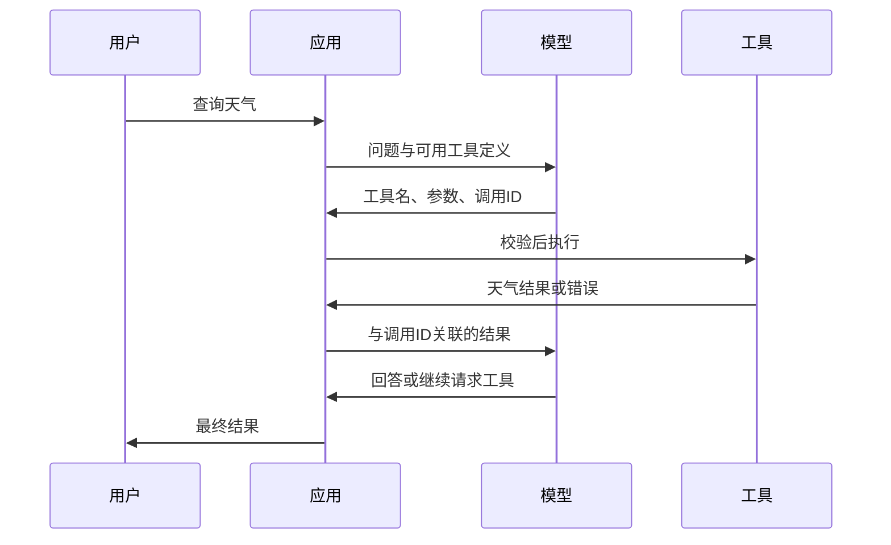

# 09：函数调用与工具使用——让模型提出请求，让程序执行

> 对应课程：Phase 11 / 09-function-calling。原文与仓库代码核对日期：2026-11-01。
> [原课正文](https://github.com/rohitg00/ai-engineering-from-scratch/blob/main/phases/11-llm-engineering/09-function-calling/docs/en.md) · [原课代码目录](https://github.com/rohitg00/ai-engineering-from-scratch/tree/main/phases/11-llm-engineering/09-function-calling/code)
> 中文解释、数值小例子与纠错为学习补充；保留原课核心实现，代码中的英文变量/接口名便于与仓库对照。


## 一、最重要的一条分工

用户问东京天气。单独的文本生成模型不会自动连接天气网站；它可以产生一个请求：`get_weather(city="Tokyo")`。应用程序收到请求，调用天气服务，把结果送回模型，模型再组织回答。

**Function calling / tool use（函数调用/工具使用）**是这种结构化协作。模型输出工具名字与参数，程序负责校验、权限、执行、返回结果。产品中看似“模型联网”实际上依赖这条执行链。



## 二、先用普通 Python 函数理解

`def add(a,b): return a+b` 中，名字是 add，a/b 是参数，调用得到返回值。工具注册表把“模型能看懂的说明”和“程序可执行的函数”连接起来。

```python
def add(a, b):
    return a + b

registry = {"add": add}  # 只有明确注册的函数可选
call = {"name":"add", "arguments":{"a":2, "b":3}}
args = call["arguments"]
assert type(args["a"]) in (int, float)
assert type(args["b"]) in (int, float)
result = registry[call["name"]](**args)  # ** 把字典展开为命名参数
print(result)  # 预期 5；这个例子没有使用模型
```

JSON Schema 是参数合同；description 告诉模型什么场景适用、参数单位和返回含义。`city`、温度单位和“实时/历史”最好清楚写出，不要只写“查天气”。

**tool_call_id / call_id** 用来把结果对回具体请求。一次请求多个工具时，仅按顺序猜对应关系会错。不同 API 的字段不同：Chat Completions 常见 assistant.tool_calls 与 tool 消息，Responses 使用 function_call 与 function_call_output，不能混写两种格式。[OpenAI 官方工具调用说明](https://developers.openai.com/api/docs/guides/function-calling)

## 三、调用选择、并行与循环

**auto** 允许模型决定调用还是直接答；**required** 要求调用工具；**指定函数**限定某个工具。强制调用不意味着参数必然正确，也不代表用户批准了动作。

东京与纽约的天气彼此独立，可以同时查。先查客户 ID 再根据 ID 查订单存在依赖，不能把第二步提前并行。多工具请求与真正并发执行也不同：程序仍要安排并发、超时和错误汇总。

**Agent loop** 重复模型决策→工具执行→观察结果，直到有最终答案或达到步数/时间/费用上限。一次工具结果失败应返回可理解的结构，如 `{"ok":false,"error":"city_not_found"}`，允许模型在有限次数内改参数。不可重复无期限调用。

## 四、结构化输出与工具的边界

最终产品信息 JSON 是给应用/用户看的数据；工具调用 JSON 是中间动作请求。格式相似但用途不同。工具需要额外处理权限、副作用与错误。

**白名单**只允许明确注册的名字；**参数校验**检查类型、范围、枚举、字段和业务规则；**授权**检查这位用户是否有权访问该资源。Schema 正确不等于授权通过。

读文件、发消息、数据库修改等动作应按作用范围执行。数据库用结构化过滤条件/参数化查询，不能把任意模型输出当 SQL；运行代码需要进程/容器隔离与资源限制，移除 builtins 或关键词过滤不能构成完整沙箱。工具返回的网页或文件可能夹有指令，仍视为不可信数据。

## 五、原文 Build It：注册表到调用循环

原课五个工具是计算器、天气、网页搜索、文件读取、代码运行。天气/搜索/文件内容主要是演示数据，不是实际联网。保留下面原文片段用于理解，但不要把其中的进程内执行过滤当成可开放给任意输入的服务。

### 步骤 1：工具注册表

同时保存给模型看的schema与程序可调用函数。两者按名字关联，get_tool_definitions不应把Python函数对象发给模型。

````python
# 本块中文说明：工具注册表
import ast
import json
import math
import time
import hashlib


TOOL_REGISTRY = {}


# 把说明/schema 与实际 Python 函数按名字登记。
def register_tool(name, description, parameters, function):
    TOOL_REGISTRY[name] = {
        "definition": {
            "type": "function",
            "function": {
                "name": name,
                "description": description,
                "parameters": parameters,
            },
        },
        "function": function,
    }
````

### 步骤 2：五个示例工具

包含计算、模拟天气/搜索/文件、代码运行。源码中的AST过滤是教学防护，不能把任意代码放进本服务进程执行。学习时只使用内置固定例子。

````python
# 本块中文说明：五个示例工具
def calculator(expression, precision=2):
    allowed = set("0123456789+-*/.() ")
    if not all(c in allowed for c in expression):
        return {"error": True, "message": f"Invalid characters in expression: {expression}"}
    try:
        result = eval(expression, {"__builtins__": {}}, {"math": math})
        return {"result": round(float(result), precision), "expression": expression}
    except Exception as e:
        return {"error": True, "message": str(e)}


WEATHER_DB = {
    "tokyo": {"temp_c": 18, "condition": "cloudy", "humidity": 72, "wind_kph": 14},
    "new york": {"temp_c": 22, "condition": "sunny", "humidity": 45, "wind_kph": 8},
    "london": {"temp_c": 12, "condition": "rainy", "humidity": 88, "wind_kph": 22},
    "san francisco": {"temp_c": 16, "condition": "foggy", "humidity": 80, "wind_kph": 18},
    "sydney": {"temp_c": 25, "condition": "sunny", "humidity": 55, "wind_kph": 10},
}


def get_weather(city, units="celsius"):
    key = city.lower().strip()
    if key not in WEATHER_DB:
        suggestions = [c for c in WEATHER_DB if c.startswith(key[:3])]
        return {
            "error": True,
            "message": f"City '{city}' not found.",
            "suggestions": suggestions,
            "code": "CITY_NOT_FOUND",
        }
    data = WEATHER_DB[key].copy()
    if units == "fahrenheit":
        data["temp_f"] = round(data["temp_c"] * 9 / 5 + 32, 1)
        del data["temp_c"]
    data["city"] = city
    return data


SEARCH_DB = {
    "python function calling": [
        {"title": "OpenAI Function Calling Guide", "url": "https://platform.openai.com/docs/guides/function-calling", "snippet": "Learn how to connect LLMs to external tools."},
        {"title": "Anthropic Tool Use", "url": "https://docs.anthropic.com/en/docs/tool-use", "snippet": "Claude can interact with external tools and APIs."},
    ],
    "MCP protocol": [
        {"title": "Model Context Protocol", "url": "https://modelcontextprotocol.io", "snippet": "An open standard for connecting AI models to data sources."},
    ],
    "weather API": [
        {"title": "OpenWeatherMap API", "url": "https://openweathermap.org/api", "snippet": "Free weather API with current, forecast, and historical data."},
    ],
}


def web_search(query, max_results=3):
    key = query.lower().strip()
    for db_key, results in SEARCH_DB.items():
        if db_key in key or key in db_key:
            return {"query": query, "results": results[:max_results], "total": len(results)}
    return {"query": query, "results": [], "total": 0}


FILE_SYSTEM = {
    "data/config.json": '{"model": "gpt-4o", "temperature": 0.7, "max_tokens": 4096}',
    "data/users.csv": "name,email,role\nAlice,alice@example.com,admin\nBob,bob@example.com,user",
    "README.md": "# My Project\nA tool-use agent built from scratch.",
}


def read_file(path):
    if ".." in path or path.startswith("/"):
        return {"error": True, "message": "Path traversal not allowed.", "code": "FORBIDDEN"}
    if path not in FILE_SYSTEM:
        available = list(FILE_SYSTEM.keys())
        return {"error": True, "message": f"File '{path}' not found.", "available_files": available, "code": "NOT_FOUND"}
    content = FILE_SYSTEM[path]
    return {"path": path, "content": content, "size_bytes": len(content), "lines": content.count("\n") + 1}


# 运行该部分示例并展示结果；函数定义后还需调用才会产生输出。
def run_code(code, language="python"):
    if language != "python":
        return {"error": True, "message": f"Language '{language}' not supported. Only 'python' is available."}
    try:
        tree = ast.parse(code)
    except SyntaxError as e:
        return {"error": True, "message": f"SyntaxError: {e}", "code": "SYNTAX_ERROR"}
    unsafe_names = {"exec", "eval", "compile", "__import__", "open", "globals", "locals", "vars", "getattr", "setattr", "delattr"}
    for node in ast.walk(tree):
        if isinstance(node, (ast.Import, ast.ImportFrom)):
            return {"error": True, "message": "Forbidden operation: import is not allowed", "code": "SECURITY_VIOLATION"}
        if isinstance(node, ast.Attribute) and node.attr.startswith("__") and node.attr.endswith("__"):
            return {"error": True, "message": "Forbidden operation: dunder attribute access is not allowed", "code": "SECURITY_VIOLATION"}
        if isinstance(node, ast.Name) and node.id in unsafe_names:
            return {"error": True, "message": f"Forbidden operation: {node.id} is not allowed", "code": "SECURITY_VIOLATION"}
    try:
        local_vars = {}
        exec(code, {"__builtins__": {"print": print, "range": range, "len": len, "str": str, "int": int, "float": float, "list": list, "dict": dict, "sum": sum, "min": min, "max": max, "abs": abs, "round": round, "sorted": sorted, "enumerate": enumerate, "zip": zip, "map": map, "filter": filter, "math": math}}, local_vars)
        result = local_vars.get("result", None)
        return {"success": True, "result": result, "variables": {k: str(v) for k, v in local_vars.items() if not k.startswith("_")}}
    except Exception as e:
        return {"error": True, "message": f"{type(e).__name__}: {e}"}
````

### 步骤 3：注册所有工具

为每个工具写用途、参数类型和required。描述中的单位、范围影响选择；schema声明不代表程序已经做了校验。

````python
# 本块中文说明：注册所有工具
def register_all_tools():
    register_tool(
        "calculator", "Evaluate a mathematical expression. Supports +, -, *, /, parentheses, and decimals. Returns the numeric result.",
        {"type": "object", "properties": {"expression": {"type": "string", "description": "Math expression, e.g. '(10 + 5) * 3'"}, "precision": {"type": "integer", "description": "Decimal places in result", "default": 2}}, "required": ["expression"]},
        calculator,
    )
    register_tool(
        "get_weather", "Get current weather for a city. Returns temperature, condition, humidity, and wind speed.",
        {"type": "object", "properties": {"city": {"type": "string", "description": "City name, e.g. 'Tokyo' or 'San Francisco'"}, "units": {"type": "string", "enum": ["celsius", "fahrenheit"], "description": "Temperature units, defaults to celsius"}}, "required": ["city"]},
        get_weather,
    )
    register_tool(
        "web_search", "Search the web for information. Returns a list of results with title, URL, and snippet.",
        {"type": "object", "properties": {"query": {"type": "string", "description": "Search query"}, "max_results": {"type": "integer", "description": "Maximum results to return", "default": 3}}, "required": ["query"]},
        web_search,
    )
    register_tool(
        "read_file", "Read the contents of a file. Returns the file content, size, and line count.",
        {"type": "object", "properties": {"path": {"type": "string", "description": "Relative file path, e.g. 'data/config.json'"}}, "required": ["path"]},
        read_file,
    )
    register_tool(
        "run_code", "Run a small Python snippet behind a static-analysis guard and a restricted interpreter. This is a teaching filter, not real isolation. Set a 'result' variable to return output.",
        {"type": "object", "properties": {"code": {"type": "string", "description": "Python code to execute"}, "language": {"type": "string", "enum": ["python"], "description": "Programming language"}}, "required": ["code"]},
        run_code,
    )
````

### 步骤 4：模拟决策与执行循环

按关键词模拟tool_calls，执行后把结果追加conversation。达到最终答案或最大轮数退出；不能将模拟关键词路由当真实模型能力。

````python
# 本块中文说明：模拟决策与执行循环
# 规则模拟模型选择工具；不要将选择结果当真实模型测试。
def simulate_model_decision(user_message, tools, conversation_history):
    msg = user_message.lower()

    if any(word in msg for word in ["weather", "temperature", "forecast"]):
        cities = []
        for city in WEATHER_DB:
            if city in msg:
                cities.append(city)
        if not cities:
            for word in msg.split():
                if word.capitalize() in [c.title() for c in WEATHER_DB]:
                    cities.append(word)
        if not cities:
            cities = ["tokyo"]
        calls = []
        for city in cities:
            calls.append({"name": "get_weather", "arguments": {"city": city.title()}})
        return calls

    if any(word in msg for word in ["calculate", "compute", "math", "what is", "how much"]):
        for token in msg.split():
            if any(c in token for c in "+-*/"):
                return [{"name": "calculator", "arguments": {"expression": token}}]
        if "+" in msg or "-" in msg or "*" in msg or "/" in msg:
            expr = "".join(c for c in msg if c in "0123456789+-*/.() ")
            if expr.strip():
                return [{"name": "calculator", "arguments": {"expression": expr.strip()}}]
        return [{"name": "calculator", "arguments": {"expression": "0"}}]

    if any(word in msg for word in ["search", "find", "look up", "google"]):
        query = msg.replace("search for", "").replace("look up", "").replace("find", "").strip()
        return [{"name": "web_search", "arguments": {"query": query}}]

    if any(word in msg for word in ["read", "file", "open", "cat", "show"]):
        for path in FILE_SYSTEM:
            if path.split("/")[-1].split(".")[0] in msg:
                return [{"name": "read_file", "arguments": {"path": path}}]
        return [{"name": "read_file", "arguments": {"path": "README.md"}}]

    if any(word in msg for word in ["run", "execute", "code", "python"]):
        return [{"name": "run_code", "arguments": {"code": "result = 'Hello from the sandbox!'", "language": "python"}}]

    return []


# 分派到注册函数执行；参数校验与权限应在该统一入口落实。
def execute_tool_call(tool_call):
    name = tool_call["name"]
    args = tool_call["arguments"]

    if name not in TOOL_REGISTRY:
        return {"error": True, "message": f"Unknown tool: {name}", "code": "UNKNOWN_TOOL"}

    tool = TOOL_REGISTRY[name]
    func = tool["function"]
    start = time.time()

    try:
        result = func(**args)
    except TypeError as e:
        result = {"error": True, "message": f"Invalid arguments: {e}"}

    elapsed_ms = round((time.time() - start) * 1000, 2)
    return {"tool": name, "result": result, "execution_time_ms": elapsed_ms}


# 管理决策、执行、返回结果和终止条件。
def run_function_calling_loop(user_message, max_iterations=5):
    conversation = [{"role": "user", "content": user_message}]
    tool_definitions = [t["definition"] for t in TOOL_REGISTRY.values()]
    all_tool_results = []

    for iteration in range(max_iterations):
        tool_calls = simulate_model_decision(user_message, tool_definitions, conversation)

        if not tool_calls:
            break

        results = []
        for call in tool_calls:
            result = execute_tool_call(call)
            results.append(result)

        conversation.append({"role": "assistant", "content": None, "tool_calls": tool_calls})

        for result in results:
            conversation.append({"role": "tool", "content": json.dumps(result["result"]), "tool_name": result["tool"]})

        all_tool_results.extend(results)
        break

    return {"conversation": conversation, "tool_results": all_tool_results, "iterations": iteration + 1 if tool_calls else 0}
````

### 步骤 5：参数验证

核对必填字段和基本类型，实际应在统一执行入口调用并扩展范围/enum/权限。未知工具不应动态eval名字。

````python
# 本块中文说明：参数验证
def validate_tool_arguments(tool_name, arguments):
    if tool_name not in TOOL_REGISTRY:
        return [f"Unknown tool: {tool_name}"]

    schema = TOOL_REGISTRY[tool_name]["definition"]["function"]["parameters"]
    errors = []

    if not isinstance(arguments, dict):
        return [f"Arguments must be an object, got {type(arguments).__name__}"]

    for required_field in schema.get("required", []):
        if required_field not in arguments:
            errors.append(f"Missing required argument: {required_field}")

    properties = schema.get("properties", {})
    for arg_name, arg_value in arguments.items():
        if arg_name not in properties:
            errors.append(f"Unknown argument: {arg_name}")
            continue

        prop_schema = properties[arg_name]
        expected_type = prop_schema.get("type")

        type_checks = {"string": str, "integer": int, "number": (int, float), "boolean": bool, "array": list, "object": dict}
        if expected_type in type_checks:
            if not isinstance(arg_value, type_checks[expected_type]):
                errors.append(f"Argument '{arg_name}': expected {expected_type}, got {type(arg_value).__name__}")

        if "enum" in prop_schema and arg_value not in prop_schema["enum"]:
            errors.append(f"Argument '{arg_name}': '{arg_value}' not in {prop_schema['enum']}")

    return errors
````

### 步骤 6：运行案例

输入不同问题，观察工具选择、参数、结果和日志。并行请求仍需调用ID对应；模拟天气不是当前实况。

````python
# 本块中文说明：运行案例
# 运行该部分示例并展示结果；函数定义后还需调用才会产生输出。
def run_demo():
    register_all_tools()

    print("=" * 60)
    print("  Function Calling & Tool Use Demo")
    print("=" * 60)

    print("\n--- Registered Tools ---")
    for name, tool in TOOL_REGISTRY.items():
        desc = tool["definition"]["function"]["description"][:60]
        params = list(tool["definition"]["function"]["parameters"].get("properties", {}).keys())
        print(f"  {name}: {desc}...")
        print(f"    params: {params}")

    print(f"\n--- Argument Validation ---")
    validation_tests = [
        ("get_weather", {"city": "Tokyo"}, "Valid call"),
        ("get_weather", {}, "Missing required arg"),
        ("get_weather", {"city": "Tokyo", "units": "kelvin"}, "Invalid enum value"),
        ("calculator", {"expression": 123}, "Wrong type (int for string)"),
        ("unknown_tool", {"x": 1}, "Unknown tool"),
    ]
    for tool_name, args, label in validation_tests:
        errors = validate_tool_arguments(tool_name, args)
        status = "VALID" if not errors else f"ERRORS: {errors}"
        print(f"  {label}: {status}")

    print(f"\n--- Tool Execution ---")
    direct_tests = [
        {"name": "calculator", "arguments": {"expression": "(10 + 5) * 3 / 2"}},
        {"name": "get_weather", "arguments": {"city": "Tokyo"}},
        {"name": "get_weather", "arguments": {"city": "Mars"}},
        {"name": "web_search", "arguments": {"query": "python function calling"}},
        {"name": "read_file", "arguments": {"path": "data/config.json"}},
        {"name": "read_file", "arguments": {"path": "../etc/passwd"}},
        {"name": "run_code", "arguments": {"code": "result = sum(range(1, 101))"}},
        {"name": "run_code", "arguments": {"code": "import os; os.system('rm -rf /')"}},
    ]
    for call in direct_tests:
        result = execute_tool_call(call)
        print(f"\n  {call['name']}({json.dumps(call['arguments'])})")
        print(f"    -> {json.dumps(result['result'], indent=None)[:100]}")
        print(f"    time: {result['execution_time_ms']}ms")

    print(f"\n--- Full Function Calling Loop ---")
    test_queries = [
        "What's the weather in Tokyo?",
        "Calculate (100 + 250) * 0.15",
        "Search for MCP protocol",
        "Read the config file",
        "Run some Python code",
        "Tell me a joke",
    ]
    for query in test_queries:
        print(f"\n  User: {query}")
        result = run_function_calling_loop(query)
        if result["tool_results"]:
            for tr in result["tool_results"]:
                print(f"    Tool: {tr['tool']} ({tr['execution_time_ms']}ms)")
                print(f"    Result: {json.dumps(tr['result'], indent=None)[:90]}")
        else:
            print(f"    [No tool called -- direct response]")
        print(f"    Iterations: {result['iterations']}")

    print(f"\n--- Parallel Tool Calls ---")
    multi_city_query = "What's the weather in tokyo and london?"
    print(f"  User: {multi_city_query}")
    result = run_function_calling_loop(multi_city_query)
    print(f"  Tool calls made: {len(result['tool_results'])}")
    for tr in result["tool_results"]:
        city = tr["result"].get("city", "unknown")
        temp = tr["result"].get("temp_c", "N/A")
        print(f"    {city}: {temp}C, {tr['result'].get('condition', 'N/A')}")

    print(f"\n--- Security Checks ---")
    security_tests = [
        ("read_file", {"path": "../../etc/passwd"}),
        ("run_code", {"code": "import subprocess; subprocess.run(['ls'])"}),
        ("calculator", {"expression": "__import__('os').system('ls')"}),
    ]
    for tool_name, args in security_tests:
        result = execute_tool_call({"name": tool_name, "arguments": args})
        blocked = result["result"].get("error", False)
        print(f"  {tool_name}({list(args.values())[0][:40]}): {'BLOCKED' if blocked else 'ALLOWED'}")
````


## 六、运行与读码路线

在本课目录执行 `python code/function_calling.py`，只需标准库；先读函数和末尾内置示例，使用固定练习输入。它模拟模型决策，不产生真实模型调用账单。控制台打印用户问题、选中的工具、参数、结果及最后回复。

推荐按顺序读：`register_tool` 保存 schema/实现→`register_all_tools` 组装列表→`simulate_model_decision` 用关键词生成调用→`validate_tool_arguments` 检查参数→`execute_tool_call` 调用实际函数→`run_function_calling_loop` 管理消息和终止。

**核对：**网页片段与仓库实现可能不完全一致，不能因为定义了 `validate_tool_arguments` 就推断每条执行路径都已调用它；接入时把验证放在唯一的 dispatcher（分发执行入口）内。教学验证器覆盖有限，尤其要注意 Python bool/int、未知字段、嵌套结构、enum、额外参数和业务权限。原 `run_code` 的 AST 拦截是教学过滤器，不是生产安全边界。max_iterations 是防循环的一道限制，还应控制单次工具耗时。

真实接入时只替换模拟决策为模型 SDK，并保存 assistant 原始调用消息及对应结果。允许最终回复和多次调用，分别处理超时、解析失败、未知工具、执行失败。跨应用复用工具时，第 14 课 MCP 可以统一发现/调用协议，但不能代替本课的授权和执行控制。

## 七、原文交付物与五项练习

工具设计卡直接写在笔记：名字、用途、输入 schema、返回 schema、单位、错误码、读写属性、权限、超时、幂等策略和示例。**幂等**指同一个操作重试不会造成额外副作用，例如用请求 ID 避免重复创建。

1. **数据库工具**：使用内存表，接受表名和过滤条件，表名白名单，运算符限制为 =、>、<、>=、<=，拒绝原始 SQL。用越权/未知列/类型不对的输入验证。
2. **错误反馈重试**：城市不存在时反馈结构化错误，最多三次；记录初次失败和重试，不把每次失败都当新独立请求。
3. **多步工具链**：模拟读配置→提取模型名字→模拟查资料。先满足前一步依赖，最多 10 轮；没有真实搜索时明确结果是演示数据。
4. **选择准确率**：30 条问题标注工具，加入无需工具和多个工具的情况，分别统计选择与参数正确率。
5. **60 秒工具缓存**：同名同参数可复用只读结果。原建议 frozenset(args.items()) 遇嵌套 list/dict 会失败，可用规范 JSON 序列化；键还应包括用户权限域/工具版本，写操作不默认缓存。

自测：模型输出“已发邮件”能证明邮件发出吗？不能，必须有实际执行结果。工具有 schema 就安全吗？不够，还需权限、范围、执行隔离和结果校验。


## 本次验证记录（2026-11-01）

仅执行原源码固定算式2+3，返回5.0；未运行任意代码工具、真实天气/网页/文件服务或模型API。

---

[返回学习导航](<00：Phase11学习导航与验证说明.md>) · [基础概念预备课](<00A：LLM应用入门预备课——API、JSON、向量与状态.md>)

[上一课](<08：LoRA与QLoRA——只训练一小部分参数的微调.md>) · [下一课](<10：LLM应用评估——测试集、评分、置信区间与回归.md>)

> 来源及许可：原课代码与文档来自 Rohit Ghumare 的 ai-engineering-from-scratch，MIT License，Copyright (c) 2026 Rohit Ghumare。中文讲解及教学纠错为补充；本章导航附完整许可声明。
