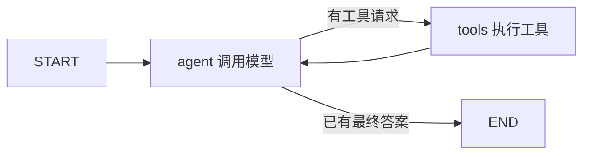

# 16：Agent 状态机——节点、边、检查点与暂停恢复

> 对应课程：Phase 11 / 16-langgraph-state-machines。原文与仓库代码核对日期：2026-11-01。
> [原课正文](https://github.com/rohitg00/ai-engineering-from-scratch/blob/main/phases/11-llm-engineering/16-langgraph-state-machines/docs/en.md) · [原课代码目录](https://github.com/rohitg00/ai-engineering-from-scratch/tree/main/phases/11-llm-engineering/16-langgraph-state-machines/code)
> 中文解释、数值小例子与纠错为学习补充；保留原课核心实现，代码中的英文变量/接口名便于与仓库对照。


## 一、从 while 循环到状态图

第09课的循环可以连续调用工具，但一旦需要暂停、恢复、分支和追踪，就需要明确记录“现在进行到哪里、有哪些已知结果、下一步做什么”。

**State 状态**是当前任务的必要数据；**Node 节点**是一个处理步骤；**Edge 边**决定下一步去哪；**State machine 状态机**根据状态和输入转移。LangGraph 提供这种图执行能力，并不把模型变聪明，也不等同于神经网络计算图。

原课最小 ReAct 图是两个业务节点 agent/tools，加 START/END 边界。原文称“四节点”时把边界也算进去，不能误认为有四个不同的业务处理函数。



## 二、状态字典与部分更新

状态可含 `messages`、`plan`、`remaining_budget`、`retrieved_docs` 等。**TypedDict** 给字典字段提供类型描述，主要帮助静态检查，不会自动对所有运行输入做严格校验。

节点接收状态、返回部分更新。例如旧状态 `{count:1,log:["开始"]}`，节点返回 `{count:2,log:["检索完成"]}`。字段如何合并由 **reducer（归并函数）**决定：count 可覆盖，log 可追加。

`Annotated[list, operator.add]` 表示列表用加法拼接；`add_messages` 还处理消息 ID 的更新等消息语义，不只是普通 append。若有 reducer，节点通常返回**新消息**，不要每次返回全部旧历史，否则可能重复。

原文“并行写同字段忘 reducer 会静默第二个覆盖”不准确：同一 super-step 多个并行写入未配置合适合并时可能直接报冲突；顺序更新才常见覆盖行为。[官方 Graph API](https://docs.langchain.com/oss/python/langgraph/graph-api)

## 三、编译、线程与检查点

**compile** 把节点/边定义变成可执行对象，并可挂 checkpointer（检查点保存器）。这里不是把 Python 编译成机器码。

**thread_id** 是某个工作流会话标识，不是操作系统线程。**checkpoint_id** 标记其中某个状态快照。恢复还需要相同存储、正确配置和兼容状态结构；同一字符串不会自动从已丢失的内存里找回内容。

MemorySaver/InMemorySaver 在进程内存中保存，进程结束即丢；SQLite/Postgres 等可实现持久化。原文“暂停后没有东西留在内存，都会持久化”不适用于纯内存保存器。检查点通常按执行 super-step 保存，并非保证任意代码行都能续跑。

**Time travel** 从旧检查点分叉执行，便于对比路线，但不会撤销已经发生的现实副作用，比如发过的消息不会自动收回。重放节点要有幂等控制，避免重复执行写操作。

## 四、两种暂停恢复不能混用

**静态断点** `interrupt_before=["tools"]` 在指定节点前停，常用于调试，继续一般使用 `app.invoke(None, config)`。它不自行读取审批结果。

**动态 interrupt()** 在节点内提出问题，恢复用 `Command(resume=...)` 把值交回中断位置；节点代码需要检查这个值，再决定是否执行动作。原文把静态断点和 Command(resume=True) 混在一起，应分开理解。[官方中断说明](https://docs.langchain.com/oss/python/langgraph/interrupts)

动态中断恢复时节点可能从头重新执行，因此中断之前不要放不可重复的副作用。审批必须在动作之前，恢复值为 False 时要真的走拒绝分支，而不是只是打印“用户拒绝”。

## 五、流式、并行和子图

`stream_mode="updates"` 输出各节点更新，`"values"` 输出状态快照，`"messages"` 可输出模型消息片段与元数据。原文部分叙述写 mode，实际例子/接口使用 stream_mode，二者不要混淆。

**Send** 动态发出若干工作项，每项带自己的状态；之后用 reducer 聚合。**Subgraph 子图**把完整子流程当父图节点，需要处理父子状态映射及检查点配置，并非所有子图默认都有完全独立持久存储。

并行不是无限制开任务，仍应控制并发、共享预算与失败恢复。图也不保证不会无限循环，应设置终止条件和 recursion_limit 等上限。

## 六、原文 Build It：节点和图的接法

以下保留原文关键片段，但其中 llm、tools 等变量需要外部定义，接口与暂停方式的修正见上文。完整仓库脚本调用 Anthropic 模型；它与无需 API 的本地状态机不是同一类验证。

### 步骤 1：状态与节点

messages使用Annotated及add_messages reducer；agent调用模型，tools执行工具，条件边按是否存在tool_calls选择下一步。llm和tools需先定义。

````python
# 本块中文说明：状态与节点
from typing import Annotated, TypedDict
from langchain_core.messages import AnyMessage, HumanMessage, AIMessage
from langgraph.graph import StateGraph, END
from langgraph.graph.message import add_messages
from langgraph.prebuilt import ToolNode
from langgraph.checkpoint.memory import MemorySaver

class State(TypedDict):
    messages: Annotated[list[AnyMessage], add_messages]

def agent_node(state: State) -> dict:
    response = llm.invoke(state["messages"])
    return {"messages": [response]}

def should_continue(state: State) -> str:
    last = state["messages"][-1]
    return "tools" if getattr(last, "tool_calls", None) else END

tool_node = ToolNode(tools=[search_web, read_file])

graph = StateGraph(State)
graph.add_node("agent", agent_node)
graph.add_node("tools", tool_node)
graph.set_entry_point("agent")
graph.add_conditional_edges("agent", should_continue, {"tools": "tools", END: END})
graph.add_edge("tools", "agent")

app = graph.compile(checkpointer=MemorySaver())
````

### 步骤 2：按thread运行

config里设置thread_id，使用stream_mode=updates逐步看到节点增量。线程ID是持久状态标识，不是操作系统线程。

````python
# 本块中文说明：按thread运行
config = {"configurable": {"thread_id": "user-42"}}
for event in app.stream(
    {"messages": [HumanMessage("find the Anthropic headquarters address")]},
    config,
    stream_mode="updates",
):
    print(event)
````

### 步骤 3：暂停与恢复

原课将静态interrupt_before与Command(resume=True)混用，此处保留供定位；正确区分见正文及补充动态interrupt示例。不要直接把这个片段当已验证审批实现。

````python
# 本块中文说明：暂停与恢复
app = graph.compile(
    checkpointer=MemorySaver(),
    interrupt_before=["tools"],  # pause before every tool call
)

state = app.invoke({"messages": [HumanMessage("delete the production database")]}, config)
# state["__interrupt__"] is set. Inspect proposed tool calls.
# If approved:
from langgraph.types import Command
app.invoke(Command(resume=True), config)
# If denied: write a rejection message and resume
app.update_state(config, {"messages": [AIMessage("Blocked by human reviewer.")]})
````

### 步骤 4：检查点历史与分叉

get_state_history使用config；从旧snapshot.config继续会重放后续，不能撤销现实副作用。输入None和提供新更新含义不同。

````python
# 本块中文说明：检查点历史与分叉
history = list(app.get_state_history(config))
for snapshot in history:
    print(snapshot.values["messages"][-1].content[:80], snapshot.config)

# Fork from a prior checkpoint
target = history[3].config  # three steps back
for event in app.stream(None, target, stream_mode="values"):
    pass  # replay from that point forward
````

### 步骤 5：持久保存器

替换MemorySaver为数据库支持实现，管理连接生命周期、初始化schema和权限。片段依赖相应checkpoint扩展库，不是只改类名就完成生产持久化。

````python
# 本块中文说明：持久保存器
from langgraph.checkpoint.postgres import PostgresSaver

with PostgresSaver.from_conn_string("postgresql://...") as checkpointer:
    checkpointer.setup()
    app = graph.compile(checkpointer=checkpointer)
````


## 七、补充：不连模型也能学会暂停恢复

下面是采用动态中断的最小图，安装 langgraph 后可运行；本次仅做语法检查，未安装该依赖执行。它只更新内存日志，不执行真实写操作。

```python
from typing import TypedDict
from langgraph.graph import StateGraph, START, END
from langgraph.checkpoint.memory import InMemorySaver
from langgraph.types import interrupt, Command

class State(TypedDict):
    approved: bool
    result: str

def review(state):
    # 首次运行在这里暂停；resume 的值会成为 approved。
    approved = interrupt({"question":"是否继续这个模拟任务？"})
    return {"approved": bool(approved)}

def finish(state):
    # 只有读状态并分支，才真正落实审批结果。
    return {"result": "模拟完成" if state["approved"] else "已取消"}

builder = StateGraph(State)
builder.add_node("review", review)
builder.add_node("finish", finish)
builder.add_edge(START, "review")
builder.add_edge("review", "finish")
builder.add_edge("finish", END)
app = builder.compile(checkpointer=InMemorySaver())
config = {"configurable":{"thread_id":"learning-demo"}}

paused = app.invoke({"approved":False, "result":""}, config)
assert "__interrupt__" in paused
completed = app.invoke(Command(resume=True), config)
print(completed["result"])  # 预期：模拟完成
```

换另一个 thread_id 并 resume=False 应得到“已取消”。同进程保存器只支持本次进程生命周期；要验证重启恢复需换持久存储并正确管理连接生命周期。

## 八、仓库运行与验收

完整脚本位置 `code/main.py`，依赖 langgraph、langchain-anthropic、环境变量 ANTHROPIC_API_KEY，模型可由 LLM_MODEL 指定。运行前先修正静态暂停的恢复逻辑，检查计算器工具的边界；原计算器使用字符白名单加 eval，仍不能视为通用安全沙箱。web_lookup 是固定字典，不是真实网页搜索。

预期可观察状态更新、待执行工具、检查点历史和分叉执行。没有 API 账户时无需强行跑该脚本，先用上面无需模型的图掌握机制。本次未调用付费端点。

## 九、原文练习和设计卡

1. 搭 agent/tools 循环，两轮对话，查看 `list(app.get_state_history(config))`，观察而不是盲背固定检查点数量；边界/执行步数会影响数量。
2. 加 planner 写结构化 plan，验证暂停恢复后仍在；列表是追加还是覆盖按语义设计，不是所有列表都必须累加。
3. 做 researcher/writer/reviewer 子图，研究完成后在写入前审批，分叉回放时确认不会重复现实写入；不同分支可能共享依赖，不能保证永远只跑单一节点。

设计卡包含节点、字段及 reducer、边/路由、终止条件、保存器、恢复入口、审批点、幂等键、可见事件。学会后应能回答“停在哪里、状态存在哪里、恢复会重做什么、谁批准什么”。


## 本次验证记录（2026-11-01）

仅语法检查原文与补充代码；未安装运行LangGraph、未执行真实模型、数据库恢复或动态中断。

---

[返回学习导航](<00：Phase11学习导航与验证说明.md>) · [基础概念预备课](<00A：LLM应用入门预备课——API、JSON、向量与状态.md>)

[上一课](<15：提示前缀缓存——复用输入计算，而非复用整段答案.md>) · [下一课](<17：Agent框架取舍——先看任务结构，再选工具.md>)

> 来源及许可：原课代码与文档来自 Rohit Ghumare 的 ai-engineering-from-scratch，MIT License，Copyright (c) 2026 Rohit Ghumare。中文讲解及教学纠错为补充；本章导航附完整许可声明。
